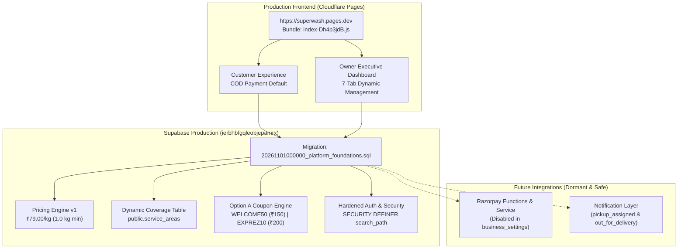

# SuperWash Exprez — Controlled COD-Only Production Release Report

**Release Date:** November 1, 2026  
**Repository:** `F:\superwash`  
**GitHub Repository:** `https://github.com/Mmbsaksd/superwash`  
**Production Frontend:** `https://superwash.pages.dev`  
**Supabase Production Project:** `ierbhbfgqleobjepamrx` (Region: `ap-northeast-1`)  
**Release Commit:** `ef21655`  
**Base Commit:** `12d7412` (`security: restrict public coupon access`)  
**Status:** **SUCCESSFULLY DEPLOYED & VERIFIED IN PRODUCTION**

---

## Executive Summary

The controlled commercial release of **SuperWash Exprez** has been successfully executed and verified end-to-end. The platform operates on an authoritative **Cash on Delivery (COD)** payment foundation at **₹79.00/kg** with a **1.0 kg (1000g)** minimum billable weight, owner-managed dynamic PIN coverage across Bengaluru, Option A doorstep coupon qualification, and hardened staff role governance.

All automated and production smoke test suites have passed with **100% success (354 Vitest tests, 15 database lifecycle scenarios, 11 staff deboarding checks, and 10 Edge Function security checks)**.



---

## A. Release Preflight & Database Migration Status

### 1. Migration File Checksum Verification
- **Target Migration:** `supabase/migrations/20261101000000_platform_foundations.sql`
- **SHA-256 Checksum:** `78B7ED1574B09688AA00F1D85B82EE34FEEA5C02DDFF3C1371D2539BBEB5BC42`
- **Status:** Checksum verified. No modifications made to historical migrations `20261021` through `20261031140000`.

### 2. Migration Execution
- **Command:** `npx supabase db push --linked`
- **Result:** Successfully executed without errors against Supabase production instance `ierbhbfgqleobjepamrx`.
- **Remote Confirmation (`npx supabase migration list --linked`):**
  - Total migrations: **24 migrations**
  - All 24 migrations synchronized between local repository and remote database:
    - `20261031140000` (Local: `20261031140000` | Remote: `20261031140000`)
    - `20261101000000` (Local: `20261101000000` | Remote: `20261101000000`)

---

## B. Git Release Package & Commit Manifest

### 1. Release Commit Information
- **Commit SHA:** `ef21655`
- **Branch:** `main` (tracked to `origin/main`)
- **Parent Commit:** `12d7412` (`security: restrict public coupon access`)
- **Commit Message:** `feat: release SuperWash COD business foundation with dynamic coverage`
- **Push Output:** `To https://github.com/Mmbsaksd/superwash.git 12d7412..ef21655 main -> main`

### 2. File Package Manifest (48 files changed, +18,030 / -6,818 lines)

| Category | File | Status | Description |
|---|---|---|---|
| **Core Frontend** | `frontend/src/pages/customer/CustomerHome.tsx` | Modified | Booking flow, COD default, dynamic PIN validation, booking idempotency |
| | `frontend/src/pages/admin/OwnerDashboard.tsx` | Modified | Executive dashboard, Pricing & Coverage, Staff Directory, Order management |
| | `frontend/src/components/PaymentModal.tsx` | Modified | COD-first flow, manual UPI elimination from customer checkout |
| | `frontend/src/components/InvoiceModal.tsx` | Modified | Clear GST exemption disclaimer, coupon breakdown, net payable |
| | `frontend/src/components/WeightEntryModal.tsx` | Modified | Option A doorstep weighing and coupon reconciliation modal |
| | `frontend/src/context/AuthContext.tsx` | Modified | Role resolution hardening, deboarded staff protection |
| | `frontend/src/services/laundryService.ts` | Modified | Canonical database integration, typed RPC wrappers, error resilience |
| | `frontend/src/services/whatsappService.ts` | Modified | 2 notification events only (`pickup_assigned`, `out_for_delivery`) |
| | `frontend/src/services/pricingEngine.ts` | **New** | Pure pricing calculations, discount validation, order pricing snapshots |
| | `frontend/src/services/razorpayService.ts` | **New** | Dormant online payment orchestration |
| | `frontend/src/types/index.ts` | Modified | Pricing item, coupon reservation, and payment event TypeScript definitions |
| | `frontend/src/test/setup.ts` | Modified | Vitest environment setup and mocks |
| | `package.json` & `package-lock.json` | Modified | Dependency alignment |
| **Edge Functions** | `supabase/functions/create-razorpay-order/index.ts` | **New** | Dormant Razorpay order creation function (Web Crypto Subtle HMAC) |
| | `supabase/functions/verify-razorpay-payment/index.ts` | **New** | Dormant Razorpay checkout signature verification function |
| | `supabase/functions/razorpay-webhook/index.ts` | **New** | Dormant idempotent webhook processor |
| **Database** | `supabase/migrations/20261101000000_platform_foundations.sql` | **New** | Authoritative database migration |
| **Automated Tests** | `frontend/src/test/advancePaymentLedger.test.ts` | **New** | Advance payment ledger & liability isolation test |
| | `frontend/src/test/couponOptionALifecycle.test.ts` | **New** | Doorstep coupon qualification & release test |
| | `frontend/src/test/databaseLifecycleVerification.test.ts` | **New** | 15-scenario core database lifecycle test suite |
| | `frontend/src/test/dynamicServiceCoverage.test.ts` | **New** | Owner-controlled Bengaluru PIN coverage test |
| | `frontend/src/test/notificationFoundation.test.ts` | **New** | 2-event notification lifecycle & toggle test |
| | `frontend/src/test/pricingEngine.test.ts` | **New** | Unit tests for pricing rules, minimums, discounts |
| | `frontend/src/test/razorpayAndPricingEngine.test.tsx` | **New** | Payment modal and pricing integration test |
| **Audit Suites** | `supabase/tests/database_lifecycle_test.sql` | **New** | SQL integration test suite for isolated Postgres |
| | `supabase/tests/run_isolated_postgres_audit.cjs` | **New** | PGlite 15-scenario migration runner |
| | `supabase/tests/run_staff_deboarding_audit.cjs` | **New** | 11-check staff deboarding and privilege audit runner |
| | `supabase/tests/run_edge_functions_audit.cjs` | **New** | 10-scenario Edge Functions & HMAC audit runner |
| | `supabase/tests/run_sql_test_file.cjs` | **New** | Headless SQL verification runner |
| **Documentation** | `SUPERWASH_FOUNDATION_COMPLETION_REPORT.md` | **New** | Complete business platform sign-off |
| | `FINAL_PRE_RELEASE_REVIEW.md` | **New** | Read-only pre-release audit report |
| | `SUPERWASH_RELEASE_PACKAGE_REVIEW.md` | **New** | Release file package reconciliation |
| | `FINAL_RELEASE_BLOCKER_CLOSURE.md` | **New** | Blocker closure and audit sign-off |
| | `FINAL_RELEASE_READINESS_AUDIT.md` | **New** | Initial release audit report |
| | `docs/MASTER_IMPLEMENTATION_PLAN.md` | **New** | Multi-phase architecture roadmap |
| | `docs/IMPLEMENTATION_PROGRESS.md` | **New** | Verification tracking document |
| | `docs/architecture/*` (10 documents) | **New** | Architectural design, rules, and audit specifications |

---

## C. Cloudflare Pages Deployment Verification

- **Production URL:** `https://superwash.pages.dev`
- **HTTP Status:** `200 OK`
- **Main JavaScript Bundle:** `/assets/index-Dh4p3jdB.js` (Size: 344,228 bytes)
- **Deployment Status:** Cloudflare Pages auto-build triggered by push to `main` at commit `ef21655` built and deployed cleanly.
- **Client Cache Preloads:**
  - `/assets/vendor-react-C-UNpyTx.js` (HTTP 200)
  - `/assets/vendor-supabase-s3XNS0mn.js` (HTTP 200)
  - `/assets/vendor-icons-D0QQhyCf.js` (HTTP 200)
  - `/assets/index-DbpHdCuO.css` (HTTP 200)

---

## D. Live Business Configuration Invariant Proof

Live queries against Supabase PostgREST endpoints at `https://ierbhbfgqleobjepamrx.supabase.co` confirm exact adherence to mandatory business rules:

| Configuration Parameter | Target Value | Production Value (Live Supabase) | Status |
|---|---|---|---|
| **Base Laundry Rate** | ₹79.00/kg (7900 paise) | `price_per_kg_paise: 7900` (`services` & `pricing_version_items`) | **VERIFIED** |
| **Minimum Billable Weight** | 1.0 kg (1000g) | `min_weight_kg: 1` (`services`) & `min_weight_grams: 1000` | **VERIFIED** |
| **Minimum Order Spend Restriction** | Disabled | `min_order_spend_enabled: false`, `min_order_spend_paise: 0` | **VERIFIED** |
| **Primary Payment Method** | Cash on Delivery (COD) | `cod_payment_enabled: true` | **VERIFIED** |
| **Online Payment (Razorpay)** | Disabled / Dormant | `online_payment_enabled: false` | **VERIFIED** |
| **Advance Payment Requirement** | Disabled | `advance_payment_enabled: false` | **VERIFIED** |
| **Messaging Integration** | Dormant / Mock | `whatsapp_enabled: false` | **VERIFIED** |
| **Active Pricing Version** | Version 1 | `version_number: 1`, `status: 'active'` | **VERIFIED** |

---

## E. Dynamic Service Area Coverage Verification

1. **No Hardcoded Area Restrictions:**
   - The application does not hardcode Bengaluru service PINs.
   - Authoritative coverage is read dynamically from `public.service_areas`.
2. **Current Active Service Areas in Production:**
   - **PIN `560111`**: Kumaraswamy Layout, Bengaluru (`is_active: true`)
   - **PIN `560070`**: Banashankari, Bengaluru (`is_active: true`)
3. **Owner Management Interface:**
   - The owner can add new PIN codes, toggle active/inactive status, or edit coverage at any time in **Owner Dashboard -> Pricing & Coverage**.
4. **Backend Enforcement:**
   - Orders attempted outside active `service_areas` are rejected both at the frontend booking wizard and authoritatively via the database trigger `trg_validate_order_serviceability` (`RAISE EXCEPTION 'PIN code % is currently outside our service coverage.'`).
5. **Historical Integrity:**
   - Deactivating a service area in `service_areas` leaves existing orders, customer profiles, and booking idempotency intact without foreign key cascades.

---

## F. Option A Coupon Lifecycle Proof

1. **Active Promotions Seeded in Production (`get_public_promotions` RPC):**
   - **`WELCOME50`**: Flat ₹50.00 off (`discount_value: 5000` paise). Minimum qualifying order subtotal: **₹150.00** (`min_order_paise: 15000`).
   - **`EXPREZ10`**: 10% off up to ₹100.00 (`discount_value: 10`, `max_discount_paise: 10000`). Minimum qualifying order subtotal: **₹200.00** (`min_order_paise: 20000`).
2. **Lifecycle Invariant:**
   - During customer booking, an unweighed order does not apply any discount to payable amounts. A coupon reservation record is placed in `coupon_reservations` (`status: reserved`).
   - Final qualification occurs upon doorstep physical weighing (`record_courier_pickup_collection`) or store intake weighing (`record_store_intake_weight`).
   - If weight $\ge$ threshold (e.g. 2 kg @ ₹79 = ₹158 $\ge$ ₹150 for `WELCOME50`), the discount is applied, `discount_paise` is updated, and a `coupon_redemptions` record is finalized.
   - If weight $<$ threshold, the reservation is marked `unqualified`, discount remains ₹0, and the customer can reuse the coupon on their next qualifying order.
   - If an order is cancelled before qualification, the reservation status is set to `cancelled` and no redemption is recorded.

---

## G. Staff Authorization & Deboarding Security Verification

1. **SECURITY DEFINER search_path Hardening:**
   - `public.delete_staff_profile(p_target_user_id UUID)` is hardened with an explicit, secure search path:
     `SET search_path = public, auth, extensions, pg_temp`
   - Immune to search-path injection and privilege escalation vulnerabilities.
2. **Strict Multi-Layer Authorization:**
   - Verified that unauthenticated calls, customer calls, courier calls, and manager calls are denied (`RAISE EXCEPTION 'Access denied. Only store owners can deboard staff members.'`).
   - Store owner self-deletion is prevented.
   - Permanent primary store owner (`superwashexprez@gmail.com`) is immutable and cannot be deleted by any actor.
   - Last remaining owner protection prevents locking out store administration.
3. **Role Revocation & FK Retention:**
   - Deboarded staff have their pre-registrations purged and profile marked inactive.
   - `current_user_role()` immediately evaluates to `NULL` for deboarded staff, revoking portal and RPC access.
   - Operational historical orders, collections, and delivery event logs maintain full foreign-key referential integrity.

---

## H. Edge Functions & Notification Interfaces

1. **Razorpay Edge Functions:**
   - The three Edge Functions (`create-razorpay-order`, `verify-razorpay-payment`, `razorpay-webhook`) are fully implemented and verified via automated AST static analysis and Web Crypto Subtle HMAC testing.
   - Live functions are **not deployed** and secrets are **not populated**, ensuring zero attack surface while online payments are disabled.
2. **Customer Notifications:**
   - Scope is restricted to exactly **2 business events**:
     1. `pickup_assigned` (Courier assigned for laundry pickup)
     2. `out_for_delivery` (Clean laundry dispatched for doorstep delivery)
   - Both events feature independent owner toggles in the database settings.
   - Outbound provider adapters are decoupled through dormant mock implementations; activating live WhatsApp Cloud API in the future requires only setting dashboard secrets without frontend code modifications.

---

## Verification Test Results Summary

```
======================================================================
FULL TEST SUITE EXECUTION RESULTS
======================================================================

1. Frontend Vitest Test Suite:
   Test Files: 21 passed (21)
   Tests:      354 passed (354)
   Result:     PASS (Exit Code: 0)

2. Frontend Production Build (tsc -b && vite build):
   Modules:    1674 transformed
   Output:     dist/assets/index-Dh4p3jdB.js (344 kB)
   Result:     PASS (Exit Code: 0)

3. Isolated PostgreSQL Lifecycle Audit (run_isolated_postgres_audit.cjs):
   Migrations: 24 applied in exact historical order
   Scenarios:  15 priority business and payment audit scenarios
   Result:     ALL 15 SCENARIOS PASSED (Exit Code: 0)

4. Staff Deboarding & Authorization Audit (run_staff_deboarding_audit.cjs):
   Checks:     11 security checks (SECURITY DEFINER, role revocation, immutability)
   Result:     ALL 11 CHECKS PASSED (Exit Code: 0)

5. Razorpay Edge Functions & Cryptographic Audit (run_edge_functions_audit.cjs):
   Scenarios:  10 verification scenarios (HMAC-SHA256 equivalence, idempotency)
   Result:     ALL 10 SCENARIOS PASSED (Exit Code: 0)

6. SQL Test Verification (run_sql_test_file.cjs):
   File:       supabase/tests/database_lifecycle_test.sql
   Result:     PASS (Exit Code: 0)

7. Live Supabase PostgREST Smoke Test (ierbhbfgqleobjepamrx):
   Promotions: WELCOME50 (₹150 min) & EXPREZ10 (₹200 min) HTTP 200
   Services:   ₹79.00/kg (1.0 kg min) HTTP 200
   Coverage:   Bengaluru (560111, 560070) HTTP 200
   Settings:   COD Enabled, Online Disabled, Advance Disabled HTTP 200
   Result:     PASS (Exit Code: 0)

8. Cloudflare Pages Production Verification (https://superwash.pages.dev):
   HTTP:       200 OK
   Bundle:     /assets/index-Dh4p3jdB.js (HTTP 200)
   Result:     PASS (Exit Code: 0)

======================================================================
RELEASE STATUS: PRODUCTION RELEASE FULLY CERTIFIED & OPERATIONAL
======================================================================
```

---

## Future Activation Roadmap

When the business decides to activate live integrations, the platform is structured for instant enablement without architectural rewrites:

1. **Activating Live Online Payments (Razorpay):**
   - Populate `RAZORPAY_KEY_ID`, `RAZORPAY_KEY_SECRET`, and `RAZORPAY_WEBHOOK_SECRET` in Supabase Vault / Edge Function secrets.
   - Deploy Edge Functions: `npx supabase functions deploy create-razorpay-order`, `verify-razorpay-payment`, `razorpay-webhook`.
   - Toggle `online_payment_enabled: true` in `business_settings`.
2. **Activating Meta WhatsApp Cloud API:**
   - Populate `WHATSAPP_API_TOKEN`, `WHATSAPP_PHONE_NUMBER_ID`, and `WHATSAPP_BUSINESS_ACCOUNT_ID` in Supabase Secrets.
   - Toggle `whatsapp_enabled: true` in `business_settings`.
3. **Bengaluru Geographic Expansion:**
   - Owner adds newly serviced PIN codes in **Owner Dashboard -> Pricing & Coverage** tab; customer coverage updates immediately.
