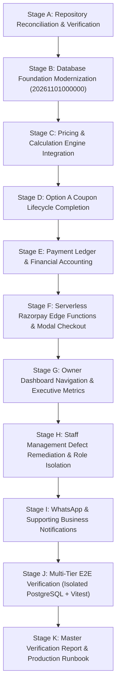

# SuperWash Exprez — Master Implementation Plan: Complete Business Platform

**Architect & Technical Lead**: Principal Software Architect & Financial Systems Lead  
**Date**: November 1, 2026  
**Repository**: `F:\superwash`  
**Production Frontend**: `https://superwash.pages.dev`  
**Supabase Production Project**: `ierbhbfgqleobjepamrx` (Region: `ap-northeast-1`)  

---

## 1. Executive Summary & Architectural Scope

SuperWash Exprez is a production-grade laundry management platform operating across retail drop-off, home pickup & doorstep weighing, washing, and delivery in Bengaluru, India. This master implementation plan defines the complete integration of the business platform, resolving all architectural gaps, modernizing financial accounting, deploying serverless Edge Functions for payment processing, rectifying staff directory defects, and preparing the pending platform database foundation.

### Core Non-Negotiables & Release Boundaries
1. **Zero Remote Modification**: Production database (`ierbhbfgqleobjepamrx`) remains strictly untouched during local development and testing. `supabase db push` and `--linked` migrations are forbidden.
2. **Preserve October Production Releases**: Production coupon security migration `20261031140000_secure_public_promotions_rpc.sql` and all historical schemas remain immutable.
3. **Strict Integer-Paise Precision**: All financial amounts are stored, calculated, and reconciled in integer paise (₹1.00 = 100 paise) to prevent floating-point financial drift.
4. **Option A Coupon Mechanics**: Coupons are reserved during booking without aborting underweight bookings; redemptions and discounts are atomically awarded at actual weighing time if qualifying.
5. **Staff Directory Integrity**: Only operational staff (`manager`, `delivery`) appear in the staff directory. Deboarded staff disappear while retaining full historical audit attribution.

---

## 2. Master Implementation Stages & Roadmap

---

## 3. Detailed Stage Breakdown

### Stage A — Latest Repository Reconciliation
- Audit Git HEAD (`12d7412`), linked Supabase status, pending migration `20261101000000_platform_foundations.sql`.
- Verify presence of Phase 5A.1 remediations:
  - Customer self-confirmation vulnerability fix in `record_order_payment`.
  - Stored procedure `record_store_intake_weight`.
  - Expanded `orders_payment_status_check` and `payments_payment_type_check` constraints.
  - Decommissioned premature cancellation trigger `trg_order_coupon_cancellation`.
  - Fixed workflow trigger assertion condition.
  - Syntax typo fix in `validate_coupon`.
- Initialize `docs/MASTER_IMPLEMENTATION_PLAN.md` and `docs/IMPLEMENTATION_PROGRESS.md`.

### Stage B — Database Foundation Finalization
- Target: `supabase/migrations/20261101000000_platform_foundations.sql`.
- Add `deleted_at TIMESTAMPTZ DEFAULT NULL` to `public.profiles` for soft-deboarding.
- Update `delete_staff_profile(UUID)`:
  - If audit records exist: set `is_active = false, deleted_at = timezone('utc', now())` and purge pending `staff_pre_registrations`.
  - If unassigned: hard delete from `public.profiles` and `public.staff_pre_registrations`.
- Verify all RPC signatures, overload drops, RLS policies, and privilege matrices.

### Stage C — Pricing & Calculation Engine Integration
- Reuse `frontend/src/services/pricingEngine.ts`.
- Integrate into:
  - `frontend/src/services/laundryService.ts`
  - `frontend/src/pages/customer/CustomerHome.tsx`
  - `frontend/src/components/WeightEntryModal.tsx`
  - `frontend/src/components/InvoiceModal.tsx`
  - `frontend/src/components/PaymentModal.tsx`
- Baseline pricing: ₹79/kg, 1.0 kg minimum billable weight, pricing versioning enabled.

### Stage D — Option A Coupon Lifecycle
- Doorstep weighing (`record_courier_pickup_collection`) and store intake weighing (`record_store_intake_weight`) implement identical Option A qualification and downward re-weighing protection.
- Preserve existing production coupons (`WELCOME50`, `EXPREZ10`).
- Reservation expiry: `GREATEST(now() + 7 days, pickup_date + 3 days)`.

### Stage E — Payment Ledger & Accounting
- Initial payment method availability: COD enabled, Razorpay enabled (after verification), Advance payments disabled by default, Manual UPI removed from customer-facing options.
- Ledger statuses: `requested`, `initiated`, `confirmed`, `failed`, `refund_requested`, `refund_completed`, `refund_failed`.
- Strict separation between customer-initiated and staff-confirmed funds.

### Stage F — Razorpay Serverless Integration
- Edge Functions:
  - `supabase/functions/create-razorpay-order/index.ts`
  - `supabase/functions/verify-razorpay-payment/index.ts`
  - `supabase/functions/razorpay-webhook/index.ts`
- Client integration: Razorpay Standard Checkout in `PaymentModal.tsx`.
- Secure server-side signature verification, idempotency on webhooks, test mode sandboxing.

### Stage G — Owner Dashboard & Business Settings
- Navigation tab order corrected:
  1. Executive Dashboard (`overview`) — DEFAULT LANDING TAB.
  2. Orders (`orders`)
  3. Payments (`payments`)
  4. Private Feedback (`feedback`)
  5. Pricing & Coverage (`settings`)
  6. Coupons (`coupons`)
  7. Staff Accounts (`staff`)
- Executive Dashboard daily metrics: today's orders, pending pickups, in process, ready for delivery, out for delivery, completed/cancelled, invoiced value vs confirmed payments, outstanding balances, operational alerts.

### Stage H — Staff Management Defect Remediation
- **Defect 1**: Deboarded/deleted staff completely disappear from active staff directory while retaining foreign key integrity for past orders and payments.
- **Defect 2**: Owners and Admins excluded from staff directory (query restricted to `role IN ('manager', 'delivery')`).
- Add comprehensive regression tests in Vitest.

### Stage I — Supporting Business Workflows & Notifications
- Support WhatsApp / business alerts across all lifecycle transitions (booking, collection, invoice, payment, delivery).

### Stage J — End-to-End Verification
- Isolated PostgreSQL WASM test suite (`run_isolated_postgres_audit.cjs` & `database_lifecycle_test.sql`).
- Full Vitest test suite (`npm test --prefix frontend -- --run`).
- Production build compilation (`npm run build --prefix frontend`).

### Stage K — Final Code Quality & Master Documentation
- Code cleanup, unused function elimination, TypeScript check.
- Compile `docs/review/MASTER_IMPLEMENTATION_REPORT.md`.

