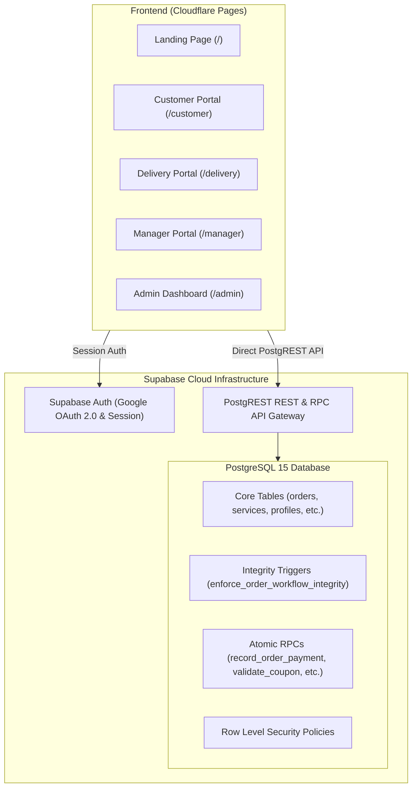

# ARCHITECTURE AUDIT REPORT
## SuperWash Exprez – Configurable Laundry Management Platform

- **Audit Date:** 2026-10-31
- **Auditor Role:** Principal Software Architect, Senior Full-Stack Engineer, Database Architect & Payment Systems Engineer
- **Repository:** `F:\superwash`
- **Application Production URL:** `https://superwash.pages.dev`
- **Database Engine:** Supabase PostgreSQL 15 (`ierbhbfgqleobjepamrx`)
- **Audit Scope:** Complete repository structure, data paths, authentication, database migrations, RLS policies, pricing engine, payment ledger, coupon mechanics, operational dashboards, and test coverage.

---

## 1. Existing System Architecture Overview

SuperWash Exprez is a mobile-first web application designed for on-demand laundry pickup and delivery in urban India (initially Bengaluru), operating on a transparent **price-per-kilogram** business model.

### 1.1 Technical Stack Inventory
- **Frontend Framework:** React 19 (`19.0.0`), React DOM (`19.0.0`), React Router DOM v7 (`7.0.2`), TypeScript (`~5.7.2`), Vite (`^6.0.3`), Tailwind CSS (`^3.4.16`).
- **Icons & UI:** Lucide React (`^0.468.0`), Leaflet (`^1.9.4`) for interactive map pin selection.
- **Backend & Database:** Supabase PostgreSQL 15 with Row Level Security (RLS), PostgreSQL functions (PL/pgSQL), triggers, and database sequences.
- **Client SDK:** `@supabase/supabase-js` (`^2.118.0`).
- **Testing Engine:** Vitest (`v2.1.8`), React Testing Library (`^16.1.0`), jsdom (`^25.0.1`).
- **Hosting / Deployment:** Cloudflare Pages with automatic Git-driven CI/CD builds connected to GitHub repository `Mmbsaksd/superwash`.
- **Legacy Python Backend:** A standalone FastAPI backend exists in `backend/app/` (SQLAlchemy, Alembic, Pydantic, SQLite/PostgreSQL, Razorpay SDK). **Key Audit Finding:** The live Cloudflare Pages web application does not communicate with `backend/` (zero `/api/` fetch calls in frontend); all live production traffic routes directly to Supabase PostgreSQL via `@supabase/supabase-js`.



---

## 2. Core Functional Portals & Component Topology

The frontend enforces strict role-based route separation managed via [`ProtectedRoute.tsx`](file:///f:/superwash/frontend/src/components/ProtectedRoute.tsx) and Supabase session role metadata:

1. **Public Portal (`/`, `/contact`, `/how-it-works`, `/privacy`, `/terms`):**
   - [`LandingPage.tsx`](file:///f:/superwash/frontend/src/pages/public/LandingPage.tsx): Displays live dynamic rate (`price_per_kg_paise`), minimum weight (`min_weight_kg`), interactive service-area PIN code validator, and active public promotion carousel.
2. **Customer Portal (`/customer`):**
   - [`CustomerHome.tsx`](file:///f:/superwash/frontend/src/pages/customer/CustomerHome.tsx): Sequential 5-step booking wizard (Schedule & Service -> Phone/Contact -> Address & GPS Map Picker -> Review & Coupon -> Confirmation), live order tracking with stage visualization, customer order history, and delivered order feedback.
3. **Delivery Associate Portal (`/delivery`):**
   - [`DeliveryDashboard.tsx`](file:///f:/superwash/frontend/src/pages/delivery/DeliveryDashboard.tsx): Split tab view for assigned pickups and deliveries. Integrated one-click phone dialer (`tel:`), Google Maps directions URL with GPS coordinates, portable scale measurement input, and doorstep cash/UPI collection.
4. **Store Manager Portal (`/manager`):**
   - [`ManagerDashboard.tsx`](file:///f:/superwash/frontend/src/pages/manager/ManagerDashboard.tsx): Queue management across operational phases (Pending Pickup, Store Intake Scale Weighing, In-Wash, Ready for Delivery). Records facility scale weight, applies billable weight constraints, and advances orders.
5. **Business Owner / Admin Portal (`/admin`):**
   - [`OwnerDashboard.tsx`](file:///f:/superwash/frontend/src/pages/admin/OwnerDashboard.tsx): Executive KPI metrics across arbitrary time periods (`today`, `yesterday`, `this_week`, `this_month`, etc.), staff role management with primary owner protection, service catalogue CRUD, service area PIN coverage, business settings, and coupon lifecycle management.

---

## 3. Database Schema & Architecture Audit

The repository contains 23 SQL migrations spanning from initial schema setup through secure public promotion RPCs.

### 3.1 Existing Database Entities
| Entity Table | Primary Key | Description & Role | Integrity Mechanism |
|:---|:---:|:---|:---|
| `public.profiles` | `id (UUID)` | User accounts extending `auth.users`. Stores role (`customer`, `delivery`, `manager`, `owner`), phone, and active status. | RLS + Trigger `check_profile_role_update` |
| `public.customer_addresses` | `id (UUID)` | Saved customer addresses with `latitude`, `longitude`, `landmark`, and `pincode`. | Unique Index `idx_customer_addresses_user_dedup` |
| `public.business_settings` | `id (UUID)` | Singleton configuration record: `price_per_kg_paise`, `min_weight_kg`, `delivery_charge_paise`, `upi_id`, `serviceable_pincodes`. | RLS (Owner-only UPDATE) |
| `public.services` | `id (UUID)` | Extensible laundry service catalogue (`Wash & Fold`, `Steam Press`, `Dry Cleaning`) with unit price and min weight. | Trigger `check_service_delete_protection` |
| `public.pickup_slots` | `id (UUID)` | Time windows (e.g. `08:00 AM - 11:00 AM`) with capacity limits. | RLS |
| `public.service_areas` | `id (UUID)` | Operational postal codes and neighborhood names. | Unique constraint on `pincode` |
| `public.orders` | `id (UUID)` | Authoritative order records. Stores customer details, address, service snapshot, scale weights, financial amounts, and order status. | Trigger `enforce_order_workflow_integrity` |
| `public.order_status_history`| `id (UUID)` | Append-only audit log tracking every status transition, timestamp, and responsible user. | Foreign Key to `orders.id` |
| `public.weight_change_history`| `id (UUID)` | Audit log recording any scale weight revisions, old vs. new amounts, and manager reason. | Foreign Key to `orders.id` |
| `public.payments` | `id (UUID)` | Individual payment transactions. Stores `amount_paise`, `payment_method`, `transaction_reference` (UTR), and `idempotency_key`. | Column-level REVOKE; RPC `record_order_payment` |
| `public.coupons` | `id (UUID)` | Promotional discount codes with discount type, discount value, `min_order_paise`, `max_discount_paise`, and redemption counters. | Migration `20261031140000` RLS lockdown |
| `public.order_feedback` | `id (UUID)` | Customer reviews (1–5 stars) on delivered orders with resolution workflow. | Check constraint `rating_overall BETWEEN 1 AND 5` |
| `public.notification_logs` | `id (UUID)` | Outbound WhatsApp event dispatch history. | RLS |

---

## 4. Comprehensive Architectural & Business Logic Audit

### 4.1 Pricing & Calculation Engine
- **Current State:**
  - Standard rate is configured at **₹79.00 / kg** (`7900` paise) with a minimum billable weight of **1.0 kg** (`min_weight_kg = 1.00`).
  - Bill calculation in [`LaundryService.calculateBill()`](file:///f:/superwash/frontend/src/services/laundryService.ts#L334) enforces:
    `billableWeightKg = Math.max(measuredWeightKg, minWeightKg)`
    `laundryChargePaise = Math.round(billableWeightKg * pricePerKgPaise)`
    `totalAmountPaise = Math.max(0, laundryChargePaise + deliveryChargePaise - discountPaise)`
  - Database trigger [`enforce_order_workflow_integrity()`](file:///f:/superwash/supabase/migrations/20261029160000_fix_order_workflow_user_role_resolution.sql#L131) enforces identical integer-paise arithmetic server-side.
- **Architectural Gaps & Technical Debt:**
  - **No Pricing Versioning Table:** The database updates `services.unit_price_paise` and `business_settings.price_per_kg_paise` in place. While existing orders retain their snapshot columns in `orders`, there is no `pricing_versions` table to schedule future price changes, maintain draft configurations, or track pricing change audit logs.
  - **Hardcoded Fallback Prices:** In fallback code branches across `laundryService.ts`, legacy values (e.g. `8000` paise or `3.0` kg) still appear in offline mocks and legacy tests.
  - **No Minimum Order Amount Restriction:** The system only supports minimum billable weight; an independent `min_order_amount_paise` configuration does not exist in `business_settings` or `orders`.

### 4.2 Actual Weight Measurement Workflow
- **Current State:**
  - Customer creates a booking **without** specifying weight (measured weight is initialized to `NULL`).
  - Doorstep scale weight can be entered by the delivery associate (`orders.pickup_measured_weight`).
  - Authoritative store intake scale weight is recorded by the store manager (`orders.measured_weight`).
  - Once measured weight is entered, billable weight and total amount are calculated and snapshot.
- **Status:** **Already Implemented & Working.**

### 4.3 Coupon & Promotion Engine (Option A Alignment)
- **Current State:**
  - Authoritative coupon validation exists via RPC `validate_coupon(p_code, p_customer_phone, p_subtotal_paise, p_service_id)`.
  - Public promotions are safely exposed via `get_public_promotions()` RPC, hiding internal redemption counters.
- **Critical Architectural Defect (Violation of Option A):**
  - Line 349 of `20261027140000_coupons_and_address_dedup.sql` rejects coupons during booking if `p_subtotal_paise < v_coupon.min_order_paise`:
    ```sql
    IF v_coupon.min_order_paise > 0 AND p_subtotal_paise < v_coupon.min_order_paise THEN
        RETURN jsonb_build_object('valid', false, 'reason', 'Minimum order subtotal required...');
    ```
  - **Required Decision Option A:** The booking estimate cannot accurately predict clothes weight. The coupon must be **provisionally reserved** at booking time and **evaluated authoritatively against the actual measured final bill** after intake weighing.
  - Furthermore, `total_redemptions` is incremented prematurely inside `create_booking_idempotent()`, rather than transitioning through `reserved -> redeemed`.

### 4.4 Payment System & Ledger
- **Current State:**
  - Current supported payment methods are strictly `'cash'` and `'upi_manual'`.
  - Doorstep payments are recorded via `record_order_payment` RPC with row locking (`SELECT FOR UPDATE`), duplicate UTR checks, and atomic balance reconciliation.
  - Check constraints in `orders` and `payments` tables restrict `payment_method IN ('cash', 'upi_manual')`.
- **Architectural Gaps & Technical Debt:**
  - **No Razorpay Integration in Live App:** The live frontend does not have Razorpay SDK integration. The only Razorpay implementation is in the decoupled `backend/` Python directory.
  - **No Advance Payment Infrastructure:** No database columns or configuration exist in `business_settings` for advance payments (`advance_payment_enabled`, `advance_payment_type`, `advance_amount_paise`).
  - **No Refunds Table:** While `payments` tracks credit transactions, refunds and payment event webhooks are not formally tracked in dedicated ledger entities.

### 4.5 Admin Configuration Capabilities
- **Current State:**
  - Owner dashboard configures per-kg rate, minimum weight, delivery charge, UPI ID, service areas, and coupons.
- **Architectural Gaps:**
  - Payment gateway settings (enabling/disabling Razorpay, COD, advance payments) do not exist in the UI.
  - Minimum order amount restrictions are missing from the settings interface.
  - Pricing version management (viewing history, drafting upcoming versions) is absent.

---

## 5. Security & Access Control Findings

1. **Authentication:** Standardized on Google OAuth 2.0 with session persistence in `localStorage`.
2. **Database Permissions:** Column-level UPDATE privileges on sensitive columns (`paid_amount_paise`, `payment_status`, `payment_method`) are revoked from authenticated client sessions. All financial mutations must route through `SECURITY DEFINER` RPCs.
3. **Primary Owner Invariant:** Permanent account `superwashexprez@gmail.com` is protected against demotion, deactivation, and deletion by database triggers and frontend predicates.
4. **Secrets Hygiene:** Zero credentials or private service-role keys are exposed in client source code or tracked files.

---

## 6. Comprehensive Audit Classification Matrix

| Domain Feature | Current Implementation Status | Assessment & Technical Debt | Production Risk |
|:---|:---:|:---|:---:|
| **Dynamic Rate Retrieval** | Already Implemented | Rate fetched from `business_settings.price_per_kg_paise` (₹79/kg) | Low |
| **Minimum Billable Weight**| Already Implemented | Enforced in `calculateBill` and database triggers (`min_weight_kg = 1.0`) | Low |
| **Separate Min Order Value**| Missing | No independent `min_order_amount_paise` rule | Low |
| **Versioned Pricing Engine**| Missing | No `pricing_versions` table; pricing edits overwrite rows in place | Medium |
| **Actual Weight Measurement**| Already Implemented | Two-stage measurement (doorstep scale + store intake scale) | Low |
| **Coupon Option A Mechanics**| Partially Implemented | Fails at booking if estimate < ₹250; increments redemption count too early | **High** |
| **Cash on Delivery (COD)** | Already Implemented | Fully working via `record_order_payment` with receipt generation | Low |
| **Razorpay Integration** | Missing (Live App) | Implemented only in legacy Python backend; absent from frontend & Supabase | Medium |
| **Advance Payment Engine** | Missing | No schema or UI; only static text copy in booking flow | Low |
| **Payment Ledger & Balance**| Already Implemented | Precise integer-paise ledger in `public.payments` | Low |
| **Refunds & Webhooks** | Missing | No `refunds` or `payment_events` tables in Supabase | Medium |
| **Admin Configuration** | Partially Implemented | Configures rate, min weight, areas, coupons; lacks gateway & advance toggles | Medium |
| **Automated Test Coverage** | Already Implemented | 14 test suites, 291 unit/integration tests with 100% pass rate | Low |

