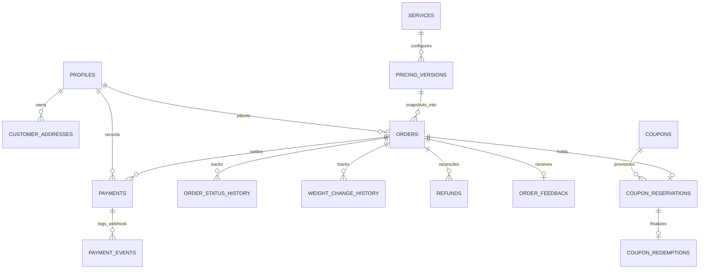

# DATABASE DESIGN & DATA MODEL SPECIFICATION
## SuperWash Exprez – Configurable Laundry Management Platform

- **Engine:** PostgreSQL 15 (Supabase Infrastructure)
- **Design Principles:** Strict Third Normal Form (3NF) core with immutable financial snapshots, row-level concurrency locking, append-only audit histories, and declarative Row Level Security.

---

## 1. Entity-Relationship Diagram (ERD)



---

## 2. Table Specifications & Schema Enhancements

### 2.1 Table: `public.pricing_versions` (New)
Maintains versioned rates, minimum restrictions, and scheduling history.

```sql
CREATE TABLE IF NOT EXISTS public.pricing_versions (
    id UUID PRIMARY KEY DEFAULT gen_random_uuid(),
    version_number VARCHAR(50) NOT NULL UNIQUE,       -- e.g. "V1.0", "V2.0-HOLIDAY"
    version_name VARCHAR(150) NOT NULL,              -- e.g. "Standard Baseline Rate"
    service_id UUID REFERENCES public.services(id) ON DELETE SET NULL,
    pricing_model VARCHAR(50) NOT NULL DEFAULT 'per_kg' CHECK (pricing_model IN ('per_kg', 'per_piece', 'flat_rate')),
    
    unit_price_paise INTEGER NOT NULL CHECK (unit_price_paise > 0), -- e.g. 7900 = ₹79.00
    min_billable_weight NUMERIC(5, 2) NOT NULL DEFAULT 1.00 CHECK (min_billable_weight >= 0),
    
    min_order_restriction_enabled BOOLEAN NOT NULL DEFAULT false,
    min_order_amount_paise INTEGER NOT NULL DEFAULT 0 CHECK (min_order_amount_paise >= 0),
    
    weight_increment_kg NUMERIC(4, 2) NOT NULL DEFAULT 0.05, -- Scale graduation step
    rounding_policy VARCHAR(30) NOT NULL DEFAULT 'nearest_integer_paise',
    
    effective_start_date TIMESTAMPTZ NOT NULL DEFAULT timezone('utc', now()),
    effective_end_date TIMESTAMPTZ,
    status VARCHAR(30) NOT NULL DEFAULT 'active' CHECK (status IN ('draft', 'scheduled', 'active', 'retired')),
    
    created_by UUID REFERENCES public.profiles(id) ON DELETE SET NULL,
    created_at TIMESTAMPTZ NOT NULL DEFAULT timezone('utc', now()),
    updated_at TIMESTAMPTZ NOT NULL DEFAULT timezone('utc', now())
);

CREATE INDEX IF NOT EXISTS idx_pricing_versions_status ON public.pricing_versions(status);
CREATE INDEX IF NOT EXISTS idx_pricing_versions_service ON public.pricing_versions(service_id);
```

---

### 2.2 Table: `public.business_settings` (Enhanced Additive Schema)
Augmented with payment gateway switches and advance payment parameters.

```sql
ALTER TABLE public.business_settings
    ADD COLUMN IF NOT EXISTS active_pricing_version_id UUID REFERENCES public.pricing_versions(id) ON DELETE SET NULL,
    ADD COLUMN IF NOT EXISTS min_order_restriction_enabled BOOLEAN NOT NULL DEFAULT false,
    ADD COLUMN IF NOT EXISTS min_order_amount_paise INTEGER NOT NULL DEFAULT 0,
    ADD COLUMN IF NOT EXISTS advance_payment_enabled BOOLEAN NOT NULL DEFAULT false,
    ADD COLUMN IF NOT EXISTS advance_payment_type VARCHAR(30) NOT NULL DEFAULT 'fixed' CHECK (advance_payment_type IN ('fixed', 'percentage', 'full')),
    ADD COLUMN IF NOT EXISTS advance_amount_paise INTEGER NOT NULL DEFAULT 0,
    ADD COLUMN IF NOT EXISTS advance_percentage NUMERIC(5, 2) NOT NULL DEFAULT 0.00,
    ADD COLUMN IF NOT EXISTS cod_enabled BOOLEAN NOT NULL DEFAULT true,
    ADD COLUMN IF NOT EXISTS razorpay_enabled BOOLEAN NOT NULL DEFAULT false,
    ADD COLUMN IF NOT EXISTS razorpay_key_id VARCHAR(100);
```

---

### 2.3 Tables: `public.coupon_reservations` & `public.coupon_redemptions` (New)
Implements Option A: Separates provisional booking allocations from finalized scale redemptions.

```sql
-- 1. Provisional Booking Reservation
CREATE TABLE IF NOT EXISTS public.coupon_reservations (
    id UUID PRIMARY KEY DEFAULT gen_random_uuid(),
    coupon_id UUID NOT NULL REFERENCES public.coupons(id) ON DELETE CASCADE,
    coupon_code VARCHAR(50) NOT NULL,
    order_id UUID NOT NULL REFERENCES public.orders(id) ON DELETE CASCADE UNIQUE,
    customer_id UUID REFERENCES public.profiles(id) ON DELETE SET NULL,
    customer_phone VARCHAR(20) NOT NULL,
    estimated_discount_paise INTEGER NOT NULL DEFAULT 0,
    status VARCHAR(30) NOT NULL DEFAULT 'reserved' CHECK (status IN (
        'reserved',            -- Booking created; awaiting physical weigh-in
        'redeemed',            -- Final measured bill qualified; discount finalized
        'ineligible_released', -- Final measured bill fell below threshold; released
        'cancelled_released'   -- Customer cancelled booking; released
    )),
    ineligible_reason TEXT,
    reserved_at TIMESTAMPTZ NOT NULL DEFAULT timezone('utc', now()),
    finalized_at TIMESTAMPTZ
);

CREATE INDEX IF NOT EXISTS idx_coupon_reservations_status ON public.coupon_reservations(status);
CREATE INDEX IF NOT EXISTS idx_coupon_reservations_code ON public.coupon_reservations(coupon_code);

-- 2. Finalized Completed Redemption
CREATE TABLE IF NOT EXISTS public.coupon_redemptions (
    id UUID PRIMARY KEY DEFAULT gen_random_uuid(),
    reservation_id UUID NOT NULL REFERENCES public.coupon_reservations(id) ON DELETE CASCADE UNIQUE,
    coupon_id UUID NOT NULL REFERENCES public.coupons(id) ON DELETE CASCADE,
    order_id UUID NOT NULL REFERENCES public.orders(id) ON DELETE CASCADE,
    customer_id UUID REFERENCES public.profiles(id) ON DELETE SET NULL,
    actual_measured_subtotal_paise INTEGER NOT NULL,
    discount_applied_paise INTEGER NOT NULL,
    redeemed_at TIMESTAMPTZ NOT NULL DEFAULT timezone('utc', now())
);
```

---

### 2.4 Table: `public.payments` (Widen Check Constraint)
Allows online payments via Razorpay alongside cash and manual UPI.

```sql
-- Drops legacy check constraint and re-creates to allow 'razorpay'
ALTER TABLE public.payments DROP CONSTRAINT IF EXISTS payments_payment_method_check;
ALTER TABLE public.payments ADD CONSTRAINT payments_payment_method_check 
    CHECK (payment_method IN ('cash', 'upi_manual', 'razorpay'));

ALTER TABLE public.orders DROP CONSTRAINT IF EXISTS orders_payment_method_check;
ALTER TABLE public.orders ADD CONSTRAINT orders_payment_method_check 
    CHECK (payment_method IN ('cash', 'upi_manual', 'razorpay'));
```

---

### 2.5 Table: `public.payment_events` (New)
Ensures webhook idempotency and complete gateway transaction history.

```sql
CREATE TABLE IF NOT EXISTS public.payment_events (
    id UUID PRIMARY KEY DEFAULT gen_random_uuid(),
    event_id VARCHAR(150) NOT NULL UNIQUE,          -- Gateway unique ID (e.g. x-razorpay-event-id)
    provider VARCHAR(50) NOT NULL DEFAULT 'razorpay',
    event_type VARCHAR(100) NOT NULL,               -- e.g. "payment.captured", "payment.failed"
    order_id UUID REFERENCES public.orders(id) ON DELETE SET NULL,
    payment_id UUID REFERENCES public.payments(id) ON DELETE SET NULL,
    payload JSONB NOT NULL,
    processed_status VARCHAR(30) NOT NULL DEFAULT 'processed' CHECK (processed_status IN ('received', 'processed', 'ignored', 'failed')),
    error_message TEXT,
    created_at TIMESTAMPTZ NOT NULL DEFAULT timezone('utc', now())
);

CREATE INDEX IF NOT EXISTS idx_payment_events_order_id ON public.payment_events(order_id);
```

---

### 2.6 Table: `public.refunds` (New)
Maintains an immutable ledger of customer refund disbursements.

```sql
CREATE TABLE IF NOT EXISTS public.refunds (
    id UUID PRIMARY KEY DEFAULT gen_random_uuid(),
    order_id UUID NOT NULL REFERENCES public.orders(id) ON DELETE CASCADE,
    payment_id UUID REFERENCES public.payments(id) ON DELETE SET NULL,
    amount_paise INTEGER NOT NULL CHECK (amount_paise > 0),
    reason TEXT NOT NULL,
    status VARCHAR(30) NOT NULL DEFAULT 'pending' CHECK (status IN ('pending', 'processed', 'failed')),
    refund_gateway_reference VARCHAR(100),
    initiated_by UUID REFERENCES public.profiles(id) ON DELETE SET NULL,
    created_at TIMESTAMPTZ NOT NULL DEFAULT timezone('utc', now()),
    processed_at TIMESTAMPTZ
);
```

---

## 3. Financial Integrity & Security Invariants

1. **Integer-Paise Precision:** All financial values (`amount_paise`, `discount_paise`, `unit_price_paise`, `subtotal_paise`) are stored strictly as 64-bit integers (`BIGINT` / `INTEGER`). Floating-point arithmetic is forbidden in database schemas and triggers.
2. **Authoritative State Enforcement:** Row updates on `orders.paid_amount_paise` and `orders.payment_status` are forbidden through direct client UPDATE; they are updated strictly through `record_order_payment()` or Edge Functions.
3. **Audit History Guarantees:** Every status change is appended to `order_status_history`, and every scale weight mutation is appended to `weight_change_history`.

