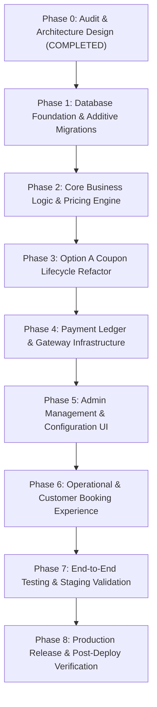

# SuperWash Exprez — Phased Implementation Roadmap

## 1. Executive Summary & Strategy

This document outlines the end-to-end engineering roadmap to transform SuperWash Exprez from its current foundation into a fully configurable, enterprise-grade laundry management platform.

### Core Guiding Principles:
1. **Zero-Downtime & Backward Compatibility**: Production is actively running at `https://superwash.pages.dev`. All database schema changes must be strictly additive. Existing orders and payment records must never be corrupted, mutated, or rendered invalid.
2. **Dynamic Configuration Driven**: No hardcoded prices (e.g. ₹79/kg) or restriction thresholds in application source code or PL/pgSQL triggers. All values resolve dynamically from database configuration tables (`pricing_versions`, `business_settings`).
3. **Option A Coupon Mechanics**: Minimum order eligibility (e.g., ₹250 threshold) is evaluated against the final weighed bill, not preliminary booking estimates. Booking applies a provisional reservation.
4. **Advance Payment True Accounting**: Advances credit toward final invoice balance; they are not service surcharges.
5. **Quality & Test Gate Enforced**: Every phase requires automated test suite passage (`npm test --prefix frontend -- --run`), migration dry-runs, and operational verification.

---

## 2. Multi-Phase Implementation Plan

---

## 3. Phase Breakdown & Execution Details

### Phase 0: Audit & Architecture Specification (Completed)
- **Status**: Completed ✅
- **Deliverables**:
  - `ARCHITECTURE_AUDIT.md`: System topology, database ERD, coupon Option A conflict analysis.
  - `PROPOSED_ARCHITECTURE.md`: Target architecture, domain boundaries, state machine.
  - `IMPLEMENTATION_GAP_ANALYSIS.md`: Component-by-component gap audit.
  - `BUSINESS_RULES.md`: Authoritative business invariants.
  - `DATABASE_DESIGN.md`: Target schema, DDL scripts, indexing strategy.
  - `PAYMENT_INTEGRATION.md`: COD, Razorpay webhook idempotency, advance payment flow.
  - `TESTING_REPORT.md`: Baseline test run (291/291 passing tests).

---

### Phase 1: Database Foundation & Additive Migrations
- **Objective**: Establish database tables and columns for versioned pricing, coupon reservations, and payment ledger without modifying existing table structure.
- **Tasks**:
  1. Create additive migration `supabase/migrations/20261101000000_platform_foundations.sql`:
     - Add `pricing_versions` table:
       - Columns: `id`, `version_number`, `effective_from`, `effective_to`, `status`, `notes`, `created_by`, `created_at`.
       - Add `pricing_version_items` table:
         - Columns: `id`, `pricing_version_id`, `service_id`, `price_paise`, `min_weight_grams`, `created_at`.
     - Enhance `business_settings`:
       - Add `advance_payment_enabled` (boolean, default `false`).
       - Add `advance_payment_type` (text, default `'fixed'`).
       - Add `advance_payment_amount_paise` (integer, default `0`).
       - Add `advance_payment_percentage` (numeric(5,2), default `0.00`).
       - Add `min_order_spend_enabled` (boolean, default `false`).
       - Add `min_order_spend_paise` (integer, default `0`).
       - Add `min_weight_restriction_enabled` (boolean, default `true`).
       - Add `min_weight_restriction_grams` (integer, default `1000`).
       - Add `online_payment_enabled` (boolean, default `false`).
       - Add `cod_payment_enabled` (boolean, default `true`).
     - Create `coupon_reservations` table:
       - Columns: `id`, `coupon_id`, `user_id`, `order_id`, `status` (`reserved`, `applied`, `expired`, `cancelled`), `expires_at`, `created_at`.
     - Create `coupon_redemptions` table:
       - Columns: `id`, `coupon_id`, `order_id`, `user_id`, `discount_paise`, `subtotal_paise`, `final_paise`, `redeemed_at`.
     - Create `payment_events` table (for webhook idempotency):
       - Columns: `id`, `event_id`, `provider`, `event_type`, `payload`, `processed_at`.
     - Widen constraint on `payments.payment_method`:
       - Allow values: `'cash'`, `'upi_manual'`, `'razorpay'`.
  2. Implement RLS policies ensuring secure staff access and user isolation.
  3. Seed initial `pricing_version` with active status:
     - Version 1: Standard Wash & Fold at ₹79.00/kg (7900 paise), min weight 1.0 kg (1000 grams).
- **Verification Gate**:
  - Run `supabase db lint` or migration validation.
  - Verify zero impact on existing queries to `orders`, `profiles`, `services`.

---

### Phase 2: Core Business Logic & Pricing Engine
- **Objective**: Implement isolated, versioned pricing engine in TypeScript and Postgres RPC with 100% test coverage.
- **Tasks**:
  1. Create `frontend/src/services/pricingEngine.ts`:
     - Function `calculateBillableWeight(measuredGrams: number, minWeightGrams: number): number`
     - Function `calculateServiceBasePrice(weightGrams: number, unitPricePaise: number, minWeightGrams: number): { billableGrams: number, basePaise: number }`
     - Function `resolveActivePricing(serviceId: string): Promise<ServicePricing>`
     - Function `validateOrderSpendRestrictions(subtotalPaise: number, settings: BusinessSettings): { isAllowed: boolean, reason?: string }`
  2. Implement Postgres RPC `get_active_pricing()`:
     - Returns active pricing items from `pricing_versions` joined with `services`.
     - Falls back to `services.price_paise` if no active version exists (fail-safe).
  3. Unit test suite `frontend/src/test/pricingEngine.test.ts`:
     - Test exact integer paise rounding.
     - Test minimum billable weight calculation:
       - 0.8 kg -> 1.0 kg billable (₹79).
       - 1.0 kg -> 1.0 kg billable (₹79).
       - 3.2 kg -> 3.2 kg billable (₹252.80 -> 25280 paise).
       - Sub-gram fractions and edge cases.
- **Verification Gate**:
  - `npm test --prefix frontend -- src/test/pricingEngine.test.ts` passes with 100% assertion success.

---

### Phase 3: Option A Coupon Lifecycle Refactor
- **Objective**: Decouple preliminary booking estimation from coupon validation; enforce coupon threshold during final invoice generation upon weight entry.
- **Tasks**:
  1. Refactor `validate_coupon` PL/pgSQL function:
     - Add `p_phase text DEFAULT 'final'` parameter.
     - If `p_phase = 'booking'`, verify coupon active, within date range, usage limit not exhausted, user per-customer quota not exceeded. **Do not reject** for preliminary subtotal being below `min_order_paise`.
     - If `p_phase = 'final'`, evaluate subtotal against `min_order_paise`.
  2. Create Postgres RPC `reserve_coupon(p_coupon_id uuid, p_order_id uuid)`:
     - Inserts record into `coupon_reservations` with status `'reserved'`.
     - Does not decrement `coupons.usage_limit`.
  3. Create Postgres RPC `finalize_order_pricing_and_coupon(p_order_id uuid, p_weight_grams integer)`:
     - Atomically calculates final subtotal using active pricing snapshot.
     - Evaluates reserved coupon against actual subtotal:
       - If subtotal >= `min_order_paise`: applies discount, creates `coupon_redemptions` record, increments usage count, marks reservation `'applied'`.
       - If subtotal < `min_order_paise`: voids discount gracefully, returns status `'coupon_threshold_unmet'`, marks reservation `'expired'`, informs customer of exact reason.
     - Updates `orders.total_amount_paise`, `orders.discount_amount_paise`, `orders.payable_amount_paise`.
  4. Create test suite `frontend/src/test/couponOptionALifecycle.test.ts`:
     - Verify booking with ₹250 coupon succeeds when estimate is ₹79.
     - Verify final weight of 4 kg (₹316) successfully claims discount.
     - Verify final weight of 2 kg (₹158) gracefully expires discount without failing the order.
- **Verification Gate**:
  - Full Vitest suite passes without regression.

---

### Phase 4: Payment Ledger & Gateway Infrastructure
- **Objective**: Implement clean, auditable payment accounting supporting COD, advance payments, and Razorpay ready-mode.
- **Tasks**:
  1. Create `frontend/src/services/paymentLedgerService.ts`:
     - Method `recordPayment(orderId, amountPaise, method, paymentType, referenceId)`
     - Method `calculateOrderBalance(orderId): Promise<{ totalPayablePaise, paidPaise, advancePaise, remainingPaise, status }>`
     - Invariant: `remainingPaise = totalPayablePaise - (advancePaise + deliveryPaymentPaise)`.
  2. Advance payment handling in order creation:
     - If `business_settings.advance_payment_enabled` is true:
       - Compute advance requirement based on configured rule (fixed amount or percentage).
       - Record advance intent in `payments` with `payment_type = 'advance'`.
       - Status remains `pending_advance` until paid.
     - If disabled (current launch state):
       - Advance requirement is ₹0.
       - Order immediately transitions to `order_confirmed`.
  3. Prepare Razorpay Gateway Service:
     - Create `frontend/src/services/razorpayService.ts` wrapper.
     - Interface with Supabase Edge Function `create-razorpay-order` when enabled.
     - Webhook receiver Edge Function `razorpay-webhook` with HMAC-SHA256 signature verification and `payment_events` idempotency tracking.
  4. Unit test suite `frontend/src/test/paymentLedger.test.ts`:
     - Test advance payment credit subtraction.
     - Test COD full collection.
     - Test overpayment protection.
- **Verification Gate**:
  - All ledger unit tests pass.

---

### Phase 5: Admin Management & Configuration UI
- **Objective**: Give business owners full control over pricing, restrictions, advance payments, and payment methods via `OwnerDashboard.tsx`.
- **Tasks**:
  1. Add **"Pricing Engine & Versions"** section to Owner Dashboard:
     - View active pricing version and history of past versions.
     - Create new draft version (unit price per kg, minimum billable weight).
     - Schedule activation date or activate immediately.
     - Ensure historical orders display the pricing version under which they were created.
  2. Add **"Business Restrictions & Minimums"** card:
     - Independent toggle: Minimum billable weight (grams) and default value (default 1000g).
     - Independent toggle: Minimum order spend (paise) and default value (default disabled).
  3. Add **"Advance Payment Settings"** card:
     - Enable/disable toggle (default: false).
     - Type selection: Fixed amount (paise) vs Percentage (%).
     - Configurable value field.
  4. Add **"Payment Gateways"** card:
     - COD toggle (default: true).
     - Razorpay toggle (default: false, disabled with "Configure API Keys" tooltip).
- **Verification Gate**:
  - Cypress/Vitest UI component tests verify form state persistence, validation guards, and audit trail logging.

---

### Phase 6: Operational & Customer Experience Updates
- **Objective**: Seamless UX across customer booking, manager processing, and delivery collection.
- **Tasks**:
  1. `CustomerHome.tsx` Booking Flow:
     - Display dynamic rate fetched from active pricing version (₹79/kg).
     - Show transparent note: *"Estimated based on standard 1 kg. Final amount calculated upon physical weigh-in."*
     - If coupon selected, show badge: *"Option A: Coupon reserved! Applicable if final order exceeds ₹250."*
     - If advance enabled: Prompt for advance payment; if COD: standard confirmation.
  2. `ManagerDashboard.tsx` & `DeliveryDashboard.tsx` Weight Recording:
     - Delivery/Manager enters exact scale weight (e.g. 3.25 kg).
     - System executes `finalize_order_pricing_and_coupon`.
     - Displays immediate invoice breakdown:
       - Measured Weight: 3.25 kg
       - Billable Weight: 3.25 kg (Min 1.0 kg)
       - Rate: ₹79.00 / kg
       - Subtotal: ₹256.75
       - Coupon (SUPER25): -₹50.00
       - Advance Paid: -₹0.00
       - Balance Due at Delivery: ₹206.75
  3. Delivery Collection:
     - Delivery partner collects ₹206.75 via COD.
     - One-click confirmation marks payment as completed and transitions order to `delivered`.
- **Verification Gate**:
  - Verify complete lifecycle from booking to delivery in manual browser tests.

---

### Phase 7: End-to-End Testing & Staging Validation
- **Objective**: Comprehensive quality assurance across all permutations.
- **Tasks**:
  1. Run complete automated Vitest test suite (`14+ suites`).
  2. Run multi-scenario edge case tests:
     - Scenario A: Order with weight below minimum (0.4 kg -> billed at 1.0 kg).
     - Scenario B: Order with coupon threshold unmet (1.5 kg = ₹118.50, coupon min ₹250 -> order completes at ₹118.50, coupon returned to customer).
     - Scenario C: Order with coupon threshold met (4.0 kg = ₹316, coupon min ₹250 -> discount applied, order bill ₹266).
     - Scenario D: Price change during active order (Order created at ₹79/kg, store changes price to ₹89/kg, order still finalized at ₹79/kg).
     - Scenario E: Advance payment order (₹50 advance paid at booking, ₹250 final bill -> delivery collects ₹200).
- **Verification Gate**:
  - Exit code 0 across all test commands. Zero console errors.

---

### Phase 8: Production Release & Post-Deploy Verification
- **Objective**: Safe rollout to Cloudflare Pages and Supabase Production.
- **Tasks**:
  1. Apply additive database migration via Supabase Dashboard / CLI.
  2. Verify PostgREST schema cache reload (`NOTIFY pgrst, 'reload schema'`).
  3. Build and test production frontend bundle (`npm run build --prefix frontend`).
  4. Push Git commits to `origin/main`.
  5. Verify Cloudflare Pages deployment status and live hash.
  6. Execute live smoke tests:
     - Check `https://superwash.pages.dev` loads without errors.
     - Create test order at ₹79/kg.
     - Verify database records.
- **Verification Gate**:
  - Production verification checklist signed off.

---

## 4. Risk Matrix & Rollback Procedures

| Risk | Likelihood | Impact | Mitigation Strategy | Rollback Action |
| :--- | :---: | :---: | :--- | :--- |
| **Option A Coupon miscalculation** | Low | High | Unit test all threshold edge cases; DB RPC validates subtotal before applying discount. | Disable coupon reservation RPC; revert to standard booking validation. |
| **Historical order price mutation** | Low | Critical | Pricing version ID and unit price stored immutably on `orders` table at creation. | RPC triggers prevent retroactive order rate changes. |
| **Payment status mismatch** | Low | High | Strict payment ledger calculates remaining balance dynamically; single source of truth. | Audit ledger with `payment_events` table; manual manager override. |
| **Schema cache desynchronization** | Medium | Medium | Include explicit cache reload notification in migration script. | Execute `NOTIFY pgrst, 'reload config'` via SQL console. |

---

## 5. Rollback Runbook

If any critical issue occurs during release:
1. **Frontend Rollback**:
   - Cloudflare Pages dashboard -> Roll back to previous immutable deployment ID (`3590b703-46d5-411e-9dc9-f9cb232e5475`). Instant (< 10 seconds).
2. **Database Rollback**:
   - Because all migrations are additive (no columns dropped, no constraints made more restrictive on existing data), rolling back the frontend causes zero database breakage.
   - New tables (`pricing_versions`, `coupon_reservations`) simply remain dormant.
3. **Emergency Support**:
   - Restore default service rate in `services` table if fallback fails.
   - Run verification test script `npm test --prefix frontend -- --run`.

