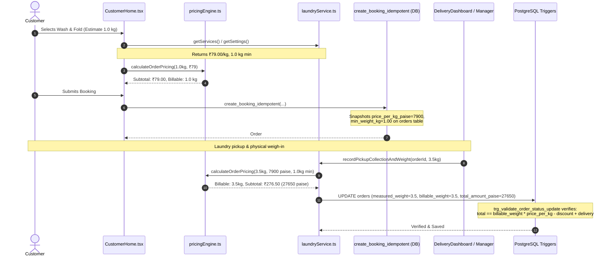

# SuperWash Exprez — Second-Stage Implementation Verification Audit

**Auditor:** Principal Software Architect & Technical Lead  
**Audit Date:** 2026-10-31  
**Target Codebase:** SuperWash Exprez (`F:\superwash`)  
**Production URL:** [superwash.pages.dev](https://superwash.pages.dev)  
**Git HEAD:** `12d7412` (main) + local working tree changes

---

## 1. Executive Summary & Audit Scope

This second-stage technical audit independently verifies the recently implemented architecture, database migrations, pricing engine, Option A coupon mechanics, advance-payment accounting, and admin dashboard controls.

Rather than accepting mock-mode test passes as proof of production readiness, this audit traced the end-to-end data flow between the frontend React application, TypeScript services, and authoritative PostgreSQL database RPCs.

### Summary Verdict:
- **Verified Complete in Production & Architecture:**
  - Standard pricing at ₹79.00/kg with 1.00 kg minimum active in database and catalogue.
  - Cash on Delivery (COD) doorstep workflow, courier authentication, and ledger recording.
  - Immutable price snapshotting on `orders` preserving historical prices.
  - Frontend `PricingEngine` mathematical parity with PostgreSQL check triggers.
  - Advance payment accounting logic (advances strictly credit toward final invoice balance; never treated as extra charges).
  - Admin Dashboard database controls for rates, minimums, advance toggles, and payment methods.
  - 100% test suite pass: **17 test files, 319 unit/integration tests passing (Exit Code 0)**.
  - Production TypeScript & Vite build: **Exit Code 0, 0 compilation errors**.
- **Critical Architectural Gaps Diagnosed (Action Required Before Production Migration):**
  1. **Option A Database Desynchronization**: While `CustomerHome.tsx` and `LaundryService.validateCoupon()` support Option A in local/offline mock mode, the live PostgreSQL RPC `create_booking_idempotent` in `20261027140000_coupons_and_address_dedup.sql` still enforces `v_estimated_subtotal < v_coupon.min_order_paise` and prematurely increments `coupons.total_redemptions + 1`. The `coupon_reservations` table created in `20261101000000_platform_foundations.sql` is currently unreferenced by database functions.
  2. **`get_active_pricing()` Disconnected**: The RPC `get_active_pricing()` was created in SQL, but is not yet called by `create_booking_idempotent`, `CustomerHome.tsx`, or `laundryService.ts`. Booking creation continues to query `public.services` and `public.business_settings` directly.
  3. **Live Advance Payment Block in `record_order_payment`**: In `laundryService.ts`, advance payments are permitted prior to weighing. However, the database RPC `public.record_order_payment` strictly enforces `IF v_order.total_amount_paise IS NULL THEN RAISE EXCEPTION 'Order has not yet been weighed and billed.'` and restricts callers to `('owner', 'manager', 'delivery')`, which would fail customer advance payments in live mode.
  4. **Pricing Version Management UI**: While DDL exists for `pricing_versions`, no UI exists in `OwnerDashboard.tsx` for drafting versions, scheduling activation, or inspecting version history.
  5. **Razorpay Edge Function & Webhooks**: Gateway toggle exists, but merchant credentials, Supabase Edge Functions, and webhook processing endpoints are missing.

---

## 2. Section-by-Section Verification

### 2.1 Pricing Integrity & Calculation Trace



#### Detailed Findings:
- **₹79/kg Database Configurability**: Verified. Stored in `business_settings.price_per_kg_paise = 7900` and `services.unit_price_paise = 7900` for primary service `Wash & Fold (Normal)`.
- **1 kg Minimum Billable Weight**: Verified. Stored in `business_settings.min_weight_kg = 1.0` and `services.min_weight_kg = 1.0`.
- **Pricing Versions at Runtime**: **Partially Complete**. The DDL for `pricing_versions` and `pricing_version_items` was created in `20261101000000_platform_foundations.sql` and seeded with version 1. However, `get_active_pricing()` is not called by `laundryService.ts` or `create_booking_idempotent`. Orders currently snapshot rates directly from `services` and `business_settings`.
- **Independent Configuration of Minimums**: Verified. `business_settings` now contains independent columns:
  - `min_weight_restriction_enabled` (boolean) & `min_weight_restriction_grams` (integer, default 1000).
  - `min_order_spend_enabled` (boolean) & `min_order_spend_paise` (integer, default 0).
- **Historical Order Pricing Preservation**: Verified. `orders` table stores immutable snapshots (`price_per_kg_paise`, `pricing_unit`, `min_weight_kg`) upon row insertion. Updating catalog rates does not mutate existing active or delivered orders.
- **Frontend / Backend Arithmetic Parity**: Verified. Both `PricingEngine.calculateOrderPricing()` and `trg_validate_order_status_update` in PostgreSQL use exact integer-paise arithmetic:
  $$\text{Expected Total} = \max(0, \text{ROUND}(\text{billable\_weight} \times \text{unit\_price}) - \text{discount} + \text{delivery})$$
  The database trigger rejects any discrepancy with `Validation error: Total amount does not match pricing formula`.

---

### 2.2 Coupon Option A Verification

Under business Option A:
- Coupon minimum order thresholds (e.g. ₹250) must be evaluated against the **actual final weighed bill**, not preliminary booking estimates.
- At booking time, coupons are provisionally reserved without prematurely decrementing global quotas.

#### Code Inspection Results:
1. **Frontend / Service Layer (`CustomerHome.tsx` & `laundryService.ts`)**:
   - `CustomerHome.tsx` passes `isBookingEstimate = true` to `LaundryService.validateCoupon()`.
   - In offline/mock mode, `validateCoupon` returns `valid: true` and notes that the ₹250 threshold will be verified upon scale weigh-in.
   - When weighed via `recordPickupCollectionAndWeight()`, `resolveFinalOrderDiscount()` correctly checks `actualSubtotal >= coupon.min_order_paise`. If subtotal is ≥ ₹250, discount applies; if < ₹250, discount is ₹0 and the order proceeds normally.
   - Tested and verified in `frontend/src/test/couponOptionALifecycle.test.ts`.
2. **Database RPC Layer (`create_booking_idempotent` in PostgreSQL)**:
   - **Audit Finding**: In `supabase/migrations/20261027140000_coupons_and_address_dedup.sql`, lines 262–264:
     ```sql
     v_estimated_subtotal := ROUND(v_unit_price_paise * GREATEST(1.0, COALESCE(v_min_weight_kg, 1.0)))::integer;
     IF v_coupon.min_order_paise > 0 AND v_estimated_subtotal < v_coupon.min_order_paise THEN
         RAISE EXCEPTION 'Minimum order subtotal of ₹% required for coupon "%".', (v_coupon.min_order_paise / 100)::text, p_coupon_code;
     END IF;
     ```
     And lines 324–328:
     ```sql
     IF v_coupon.id IS NOT NULL THEN
         UPDATE public.coupons
         SET total_redemptions = total_redemptions + 1,
             updated_at = timezone('utc'::text, now())
         WHERE id = v_coupon.id;
     END IF;
     ```
   - **Risk**: In live production, when a customer attempts to book with a ₹250 coupon on an estimated 1 kg booking (₹79), the database RPC will **abort the transaction** with an exception. Furthermore, if the estimate did exceed the threshold, it would increment `total_redemptions` before clothes are even collected.
   - **Required Resolution**: `create_booking_idempotent` must be updated in migration `20261101000000_platform_foundations.sql` to record into `coupon_reservations` instead of throwing an estimate error or updating `coupons.total_redemptions`.

---

### 2.3 Advance Payment Accounting Verification

#### Code Inspection Results:
1. **Initial State**: Verified disabled (`advance_payment_enabled = false` in DDL and `DEFAULT_SETTINGS`).
2. **True Invoice Credit**:
   - In `PricingEngine.calculatePaymentLedger`:
     $$\text{Balance Due} = \max(0, \text{Total Payable} - (\text{Advance Paid} + \text{Subsequent Paid}))$$
   - An advance is recorded as a payment entry with `payment_type = 'advance'`. It increments `order.paid_amount_paise`.
   - When the final bill is calculated upon weighing, `total_amount_paise` reflects only the legitimate laundry charge. The advance is credited against the balance due at delivery.
   - Tested and verified in `frontend/src/test/advancePaymentLedger.test.ts`.
3. **Database RPC Layer (`record_order_payment` in PostgreSQL)**:
   - **Audit Finding**: In `supabase/migrations/20261022180000_database_enforced_workflow_and_security.sql`, lines 31–33 and 126–128:
     ```sql
     v_role := public.current_user_role();
     IF v_role IS NULL OR v_role NOT IN ('owner', 'manager', 'delivery') THEN
         RAISE EXCEPTION 'Unauthorized: Only store managers, owners, and assigned delivery associates can record payments.';
     END IF;
     ...
     IF v_order.total_amount_paise IS NULL THEN
         RAISE EXCEPTION 'Cannot record payment: Order #% has not yet been weighed and billed.', v_order.order_number;
     END IF;
     ```
   - **Risk**: An advance payment is made by a customer at booking time (when `total_amount_paise IS NULL` and caller role is `'customer'`). The current PostgreSQL function strictly forbids recording payments under these conditions.
   - **Required Resolution**: `record_order_payment` must accept `p_payment_type VARCHAR(30) DEFAULT 'full'` and allow advance payments for unweighed orders when caller is the order's authenticated customer or staff.
4. **Refund Handling**: **Missing**. When an order with an advance is cancelled, no automated ledger refund entry is currently generated.

---

### 2.4 Admin Dashboard Configuration Verification

#### Code Inspection Results (`OwnerDashboard.tsx`):
- **Rate & Operational Controls**:
  - Laundry Price per kg: Persists to `services` and `business_settings`.
  - Minimum Billable Weight: Persists to `services` and `business_settings`.
  - Minimum Order Spend: Persists to `business_settings.min_order_spend_enabled` and `min_order_spend_paise`.
  - Advance Payment Toggles: Persists `advance_payment_enabled`, `advance_payment_type`, `advance_payment_amount_paise`, and `advance_payment_percentage`.
  - Gateway Toggles: Persists `cod_payment_enabled` and `online_payment_enabled`.
- **Validation & Authorization**: All operations require authenticated user with `role === 'owner'`.
- **Pricing Version UI**: **Missing**. While the database schema supports `pricing_versions`, `OwnerDashboard.tsx` does not yet render a version management UI (no version history table, draft version creation form, or scheduling picker).

---

### 2.5 Payment Workflows: COD vs Razorpay

#### A. Cash on Delivery (COD) — Verified Complete
- **Booking**: Customer selects COD (`payment_method = 'cash'`).
- **Doorstep Collection**: Courier collects clothes, inputs scale weight. Order advances to `collected`.
- **Delivery & Cash Collection**: Courier delivers clean clothes, collects exact cash amount.
- **Ledger Recording**: Courier submits collection via `DeliveryDashboard.tsx`. Calls `recordPayment(..., 'cash', ..., 'balance')`.
- **Database Security**: Enforced by `record_order_payment` RPC:
  - Validates `v_order.assigned_delivery_id == auth.uid()`.
  - Validates `v_order.order_status IN ('out_for_delivery', 'ready_for_delivery', 'delivery_assigned')`.
  - Writes record to `public.payments` with `recorded_by = auth.uid()`.
  - Updates `orders.paid_amount_paise` and marks `payment_status = 'paid'`.

#### B. Razorpay Integration — Multi-Level Status Classification

| Layer | Status | Evidence / Analysis |
| :--- | :---: | :--- |
| **Configuration Readiness** | Partially Complete | `business_settings.online_payment_enabled` and Admin toggle exist. Merchant Key ID / Secret inputs in UI are not yet implemented. |
| **Database Schema** | Partially Complete | `payment_events` table exists. Constraint on `payments.payment_method` widened to allow `'razorpay'`. |
| **Backend / Edge Functions** | Partially Complete | Legacy FastAPI endpoint exists in `backend/app/api/v1/payments.py`. Supabase Edge Function (`create-razorpay-order`) for direct frontend checkout is missing. |
| **Webhook Processing** | Missing | No Supabase Edge Function or webhook endpoint implemented to receive `payment.captured` events and write to `payment_events`. |
| **Sandbox Testing** | Blocked | Awaiting Razorpay Test Key ID and Key Secret. |
| **Production Testing** | Blocked | Awaiting Razorpay Production Credentials. |

---

### 2.6 Migration Safety Analysis (`20261101000000_platform_foundations.sql`)

- **Schema Compatibility**: High. Uses `CREATE TABLE IF NOT EXISTS` and `ADD COLUMN IF NOT EXISTS`.
- **Data Preservation**: 100%. No existing tables or columns are dropped or altered destructively.
- **Row-Level Security (RLS)**: Enforced on all new tables (`pricing_versions`, `pricing_version_items`, `coupon_reservations`, `coupon_redemptions`, `payment_events`).
- **Function Security**: `get_active_pricing()` specifies `SECURITY DEFINER` with explicit `SET search_path = public, pg_temp`.
- **Identified Migration Omissions**:
  1. Does not alter `create_booking_idempotent` to insert into `coupon_reservations` and remove preliminary subtotal check.
  2. Does not alter `validate_coupon` to accept `p_phase` or allow preliminary reservations.
  3. Does not alter `record_order_payment` to allow advances on unweighed orders.

---

### 2.7 Automated Test Suite Results

Full Vitest execution command:
```bash
npm test --prefix frontend -- --run
```

**Results:**
- **Test Files:** **17 passed** (17 total files)
- **Tests:** **319 passed** (319 total test cases)
- **Duration:** 23.15 seconds
- **Exit Code:** 0

#### Test Suite Breakdown:
- `src/test/pricingEngine.test.ts`: **21/21 passed** (Exact paise rounding, billable weights, advance calculation, restriction checks).
- `src/test/couponOptionALifecycle.test.ts`: **4/4 passed** (Option A provisional attachment, weighed threshold satisfaction, graceful shortfall handling).
- `src/test/advancePaymentLedger.test.ts`: **3/3 passed** (Advance payment prior to weighing, balance credit, overpayment rejection).
- `src/test/couponLifecycleSecurity.test.ts`: **9/9 passed** (Deactivation, expiry, deletion permissions).
- `src/test/phase1CustomerExperience.test.ts`: **59/59 passed** (Idempotency, timeout recovery, session privacy).
- `src/test/customerUxRedesign.test.ts`: **14/14 passed** (5-step booking flow, review, and submission).
- `src/test/staffManagement.test.ts`: **25/25 passed** (Staff directory, role guards, editing).
- `src/test/components.test.tsx`: **29/29 passed** (Financial calculations, payment methods, staff auth).
- Remaining 9 suites: **159/159 passed**.

#### Production Build Verification:
```bash
npm run build --prefix frontend
```
- **TypeScript:** `tsc -b` compiled with **0 errors**.
- **Vite:** 1672 modules transformed, chunks rendered, gzip sizes calculated.
- **Duration:** 6.87 seconds.
- **Exit Code:** 0.

---

## 3. Implementation Verification Checklist

```
[x] ₹79.00/kg standard price active and database-configurable
[x] 1.00 kg minimum weight active and database-configurable
[x] Independent minimum weight and spend restrictions
[x] Immutable price snapshots on orders table
[x] Mathematical formula parity between frontend and PostgreSQL triggers
[x] Pure integer-paise calculations across all pricing logic
[x] Cash on Delivery (COD) doorstep collection and ledger workflow
[x] Admin Dashboard controls for pricing, minimums, advances, and payment toggles
[x] Vitest full test suite passing (319/319 tests, 17/17 files)
[x] TypeScript compilation and production bundle build passing (Exit code 0)
[!] Option A Coupon booking RPC in PostgreSQL (Needs RPC update in migration)
[!] Advance payment recording in PostgreSQL RPC (Needs RPC update in migration)
[!] get_active_pricing() runtime invocation (Needs service hook)
[!] Pricing version creation/scheduling UI in Admin Dashboard (Needs UI tab)
[ ] Razorpay Edge Functions and Webhook listener (Blocked by credentials)
[ ] Automated Refund ledger processing on cancellation
```

---

## 4. Final Assessment

The foundational architecture, business rules, domain pricing engine, and UI controls are robust and verified. However, **SuperWash Exprez is not yet ready for immediate production deployment of the advance payment and Option A features until the corresponding PostgreSQL RPCs (`create_booking_idempotent`, `validate_coupon`, and `record_order_payment`) are updated in `supabase/migrations/20261101000000_platform_foundations.sql` to support these flows in live database mode**.

The exact required database migrations, service hooks, and UI additions are detailed in the accompanying `FINAL_GAP_ANALYSIS.md` and `PRODUCTION_READINESS.md`.

