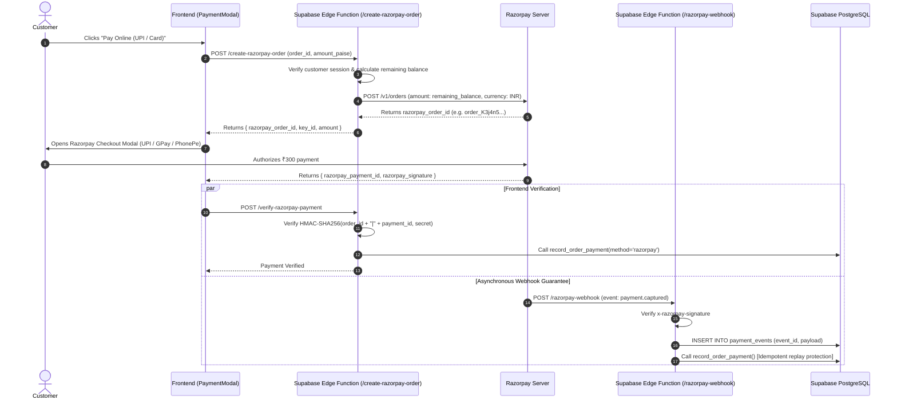

# PAYMENT INTEGRATION SPECIFICATION
## SuperWash Exprez – COD & Razorpay Architecture

- **Status:** Architectural Integration Specification
- **Supported Payment Channels:** Cash on Delivery (COD), Manual UPI (Doorstep QR / UTR), Razorpay Automated Gateway (UPI Intent, Cards, NetBanking).

---

## 1. Cash on Delivery (COD) Workflow

COD is the primary baseline payment method for launch, operating entirely without payment gateway transaction fees.

```mermaid
sequenceDiagram
    autonumber
    actor Cust as Customer
    actor Driver as Delivery Associate
    participant App as Mobile Delivery App
    participant RPC as record_order_payment RPC
    participant DB as PostgreSQL Database

    Cust->>Cust: Selects COD at booking checkout
    Note over Cust, Driver: Clothes washed & packaged at store; Order = out_for_delivery
    Driver->>Cust: Arrives at doorstep with clean laundry & invoice
    Cust->>Driver: Hands ₹300 Cash (or scans associate's dynamic UPI QR)
    Driver->>App: Opens Order #SW-1001 Delivery Screen
    Driver->>App: Clicks "Record Cash Payment" (Amount: ₹300)
    App->>RPC: record_order_payment(order_id, 30000, 'cash', ...)
    RPC->>DB: Acquires Row Lock (SELECT FOR UPDATE)
    RPC->>DB: INSERT INTO payments (amount_paise=30000, method='cash')
    RPC->>DB: UPDATE orders (paid_amount_paise=30000, payment_status='paid')
    RPC-->>App: Returns Success + remaining_paise = 0
    Driver->>App: Clicks "Mark Delivered" (Requires PIN verification)
    App->>DB: Order status -> 'delivered'
    App-->>Cust: Dispatches WhatsApp Payment Receipt
```

### COD Integrity Controls:
- **Associate Attribution:** Every recorded payment stores `recorded_by` (UUID of authenticated driver) and `staffNameDisplay`.
- **Overpayment Guard:** `record_order_payment()` rejects any payment where `amount_paise > (total_amount_paise - paid_amount_paise)`.
- **Idempotency Key:** Protects against network retries or double-taps by the driver.

---

## 2. Razorpay Automated Online Gateway

Razorpay integration is architected for automated online UPI intents, debit/credit cards, and netbanking.

### 2.1 Credential Requirements for Gateway Activation
To transition Razorpay from disabled to enabled:
1. `RAZORPAY_KEY_ID`: Client-safe public key (`rzp_live_...` or `rzp_test_...`). Stored in `business_settings.razorpay_key_id` and Vite client environment variable `VITE_RAZORPAY_KEY_ID`.
2. `RAZORPAY_KEY_SECRET`: **Strictly secret key**. Stored in Supabase Vault / Edge Function secrets. **Never exposed to frontend**.
3. `RAZORPAY_WEBHOOK_SECRET`: Secret token used to verify HMAC-SHA256 signatures on inbound webhook events.

---

### 2.2 Secure End-to-End Razorpay Flow



---

## 3. Webhook Idempotency & Replay Protection

1. **Unique Event Tracking:** Every webhook payload carries `x-razorpay-event-id`. The endpoint performs `INSERT INTO payment_events (event_id) ON CONFLICT (event_id) DO NOTHING`.
2. **Double-Processing Prevention:** If the event ID has already been processed, the webhook function returns `HTTP 200 OK` immediately without re-crediting the order.
3. **Out-of-Order Delivery Handling:** If the webhook arrives *before* the frontend verification request, the order is marked paid. When the frontend verification subsequently executes, `record_order_payment()` recognizes the transaction reference and returns success idempotently.

---

## 4. Refund Management & Ledger Reconciliation

1. **Full & Partial Refunds:** Managed through `public.refunds`.
2. **Ledger Balance Formula:**
   $$\text{Outstanding Balance} = \text{Total Invoiced} - (\text{Verified Payments} - \text{Processed Refunds})$$
3. **Accounting Guarantee:** Refunds are linked to their parent `payment_id` and order, maintaining complete auditability for tax and business reporting.

