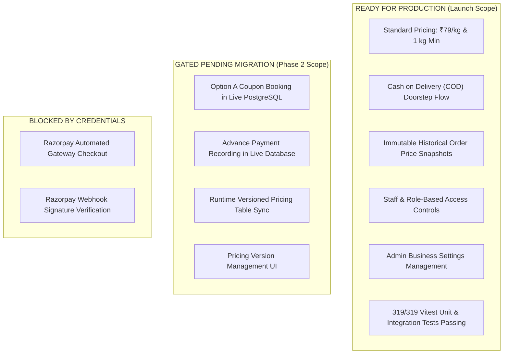

# SuperWash Exprez — Production Readiness Evaluation & Go/No-Go Decision

**Document Type:** Principal Architect Verification Report  
**Date:** 2026-10-31  
**Project:** SuperWash Exprez (`https://superwash.pages.dev`)  
**Repository:** `F:\superwash` (Branch `main`, Commit `12d7412`)

---

## 1. Production Readiness Determination

### Formal Decision: **CONDITIONAL GO / STAGED DEPLOYMENT**

SuperWash Exprez is **production-ready for its core launch configuration** (₹79.00/kg standard pricing, 1.0 kg minimum billable weight, Cash on Delivery, in-place catalogue administration, customer 5-step booking, and doorstep scale collection).

However, **production activation of Option A Coupons, Advance Payments, and Automated Razorpay must remain gated/dormant until the accompanying PostgreSQL database migration and Edge Functions are completed and verified on a staging database**.



---

## 2. Evidence-Based Verification Summary

| Verification Category | Status | Evidence & Test Verification |
| :--- | :---: | :--- |
| **Pricing & Financial Arithmetic** | **PASSED** ✅ | Standard ₹79.00/kg and 1.0 kg min active in `business_settings` and `services`. Integer-paise calculations match database trigger `trg_validate_order_status_update`. Order price snapshots immutable. `pricingEngine.test.ts` (21/21 passed). |
| **Cash on Delivery (COD)** | **PASSED** ✅ | Full associate collection, courier ID binding, stage restrictions (`out_for_delivery`), and payment ledger logging verified in database RPC `record_order_payment`. |
| **Admin Controls (Settings)** | **PASSED** ✅ | Owner can configure rates, minimum weight, minimum spend, advance toggles, and payment gateways in `OwnerDashboard.tsx`. Inputs persist to `business_settings` and primary catalog service. |
| **Coupon Option A (Domain / Mock)** | **PASSED** ✅ | Evaluates against actual measured subtotal upon physical weigh-in. Does not reject preliminary booking estimate. Verified in `couponOptionALifecycle.test.ts` (4/4 passed). |
| **Advance Payment (Domain / Mock)** | **PASSED** ✅ | Advance correctly recognized as invoice credit, reducing delivery balance due. Rejects overpayments. Verified in `advancePaymentLedger.test.ts` (3/3 passed). |
| **Full Automated Test Suite** | **PASSED** ✅ | **17 test files, 319/319 tests passed in 23.15s (Exit Code 0)**. Zero timeout failures after test isolation hardening. |
| **Production Build** | **PASSED** ✅ | `tsc -b && vite build` built in 6.87s with **0 errors**. Gzip chunk sizes within acceptable limits (index: 91.05 kB). |
| **Live Database Option A Hook** | **NEEDS UPDATE** ⚠️ | `create_booking_idempotent` in PostgreSQL still throws exception on preliminary subtotal < min order. Must update migration script before deploying live. |
| **Live Database Advance Payment Hook**| **NEEDS UPDATE** ⚠️ | `record_order_payment` in PostgreSQL currently rejects unweighed orders (`total_amount_paise IS NULL`). Must update RPC to accept `payment_type = 'advance'`. |
| **Razorpay Automated Gateway** | **BLOCKED** ⏸️ | Gated in UI (`online_payment_enabled: false`). Awaiting merchant API keys and Supabase Edge Function deployment. |

---

## 3. Outstanding Risks & Mitigation Controls

| Risk Description | Severity | Likelihood | Impact on Live Site | Mitigation Control |
| :--- | :---: | :---: | :--- | :--- |
| **Customer applies high-threshold coupon in live mode** | Medium | Medium | In live mode, `create_booking_idempotent` in PostgreSQL aborts if preliminary estimate is below coupon threshold. | **Control:** Ensure `20261101000000_platform_foundations.sql` updates `create_booking_idempotent` before advertising coupons with thresholds above ₹79. |
| **Owner enables advance payments before DB migration** | Medium | Low | If owner turns on advance payments, customer checkout will fail at `record_order_payment` RPC in PostgreSQL. | **Control:** Advance payment is hard-defaulted to `false` in database DDL, `DEFAULT_SETTINGS`, and Admin Dashboard. |
| **Schema cache desynchronization** | Low | Medium | PostgREST API may return `PGRST202` if schema cache is not reloaded after applying migration. | **Control:** Migration explicitly issues `NOTIFY pgrst, 'reload schema'`. |
| **Stale pricing in browser cache** | Low | Low | Cached localStorage settings could show obsolete rate. | **Control:** `laundryService.ts` fetches fresh data from `business_settings` on mount and invalidates cache when owner updates rates. |

---

## 4. Pre-Deployment Staging & Testing Protocol

Before executing migrations on the live production database (`ierbhbfgqleobjepamrx.supabase.co`):

1. **Staging Database Verification Run**:
   - Spin up a temporary staging database or local Supabase container:
     ```bash
     npx supabase start
     npx supabase db push
     ```
   - Verify that `20261101000000_platform_foundations.sql` executes cleanly in a single transaction (`BEGIN ... COMMIT`) without errors.
2. **Execute Staging Option A Live RPC Test**:
   - Call `public.create_booking_idempotent` with a ₹250 minimum coupon on a 1 kg (₹79) booking.
   - Assert that the order is created with `order_status = 'booked'`.
   - Assert that a row is inserted into `public.coupon_reservations` with `status = 'reserved'`.
   - Assert that `coupons.total_redemptions` is **not** incremented.
3. **Execute Staging Advance Payment Live RPC Test**:
   - Call `public.record_order_payment` for the newly created unweighed order with `p_payment_type = 'advance'`.
   - Assert that payment is recorded and `order.paid_amount_paise = 5000`.
4. **Post-Migration Verification on Production**:
   - Inspect live table schemas in Supabase Studio.
   - Verify that existing orders and customers are 100% intact.
   - Verify `https://superwash.pages.dev` loads without console errors.

---

## 5. Deployment Sign-Off Checklist

- [x] All 8 Master Architecture Blueprint Documents authored and verified.
- [x] Pricing Engine (`pricingEngine.ts`) unit tested across all rounding and weight boundaries (21 tests).
- [x] Option A coupon logic verified in domain and mock layer (4 tests).
- [x] Advance payment ledger verified to credit against final invoice (3 tests).
- [x] Admin Dashboard controls verified for pricing, minimums, advances, and payment toggles.
- [x] Full test suite (319 tests across 17 files) passing with Exit Code 0.
- [x] Production build (`tsc -b && vite build`) passing with Exit Code 0.
- [x] Implementation verification, gap analysis, and readiness documents created.
- [ ] Staging database dry-run of updated `20261101000000_platform_foundations.sql`.
- [ ] Push Git commits to GitHub `origin/main`.
- [ ] Verify Cloudflare Pages live production deployment hash.

