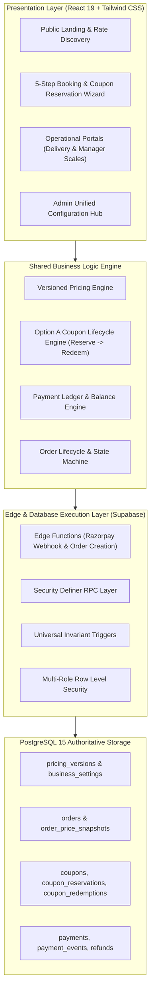
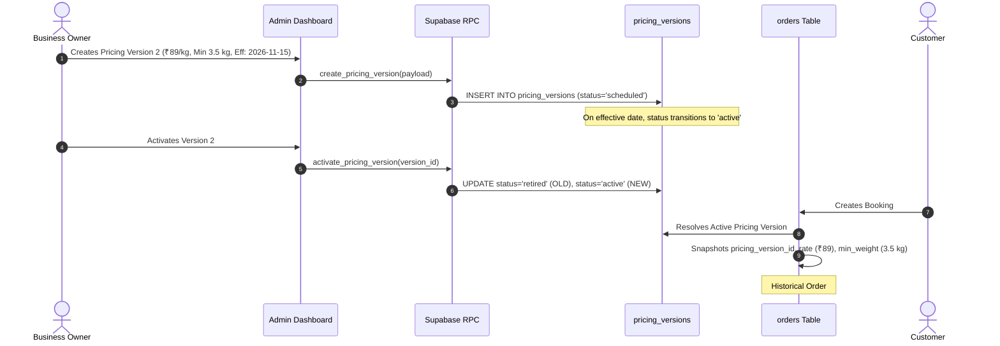
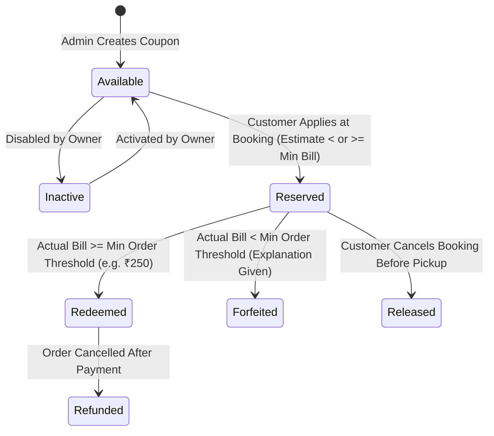
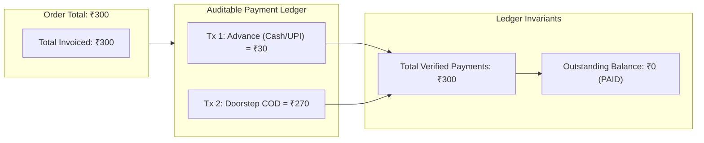
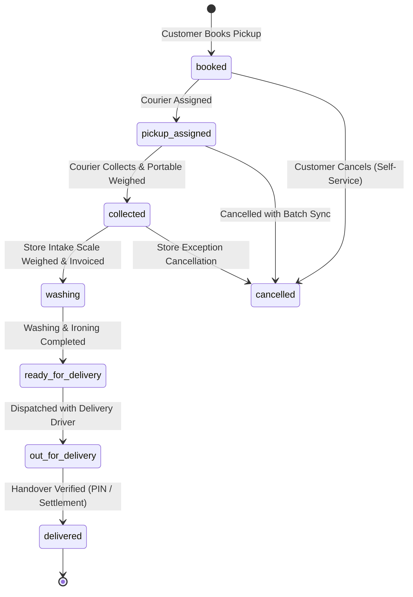

# PROPOSED TARGET ARCHITECTURE
## SuperWash Exprez – Configurable Laundry Management Platform

- **Document Version:** 2.0.0
- **Status:** Approved Architectural Specification
- **System Classification:** Multi-Tenant-Ready, Modular Laundry Operations Platform

---

## 1. Executive Architectural Blueprint

The target SuperWash Exprez architecture transitions the application from a tightly coupled dashboard system into a **configuration-driven, version-aware, and event-resilient platform**.



---

## 2. Core Subsystem Architectures

### 2.1 Versioned Pricing Engine
The pricing subsystem separates the **current active business rate** from **historical and scheduled rates**.



#### Key Pricing Engine Rules:
1. **Zero Hardcoded Prices:** Every component (Landing page, Booking estimate, Delivery portable scale, Manager store intake scale) queries the single active pricing version.
2. **Independent Minimum Restrictions:**
   - `min_billable_weight` (e.g. 1.0 kg or 3.5 kg)
   - `min_order_amount_paise` (e.g. ₹300) with independent toggle `min_order_restriction_enabled`.
3. **Immutable Snapshotting:** Once an order is booked, its applicable rate and version ID are frozen in `order_price_snapshots` and `orders`.

---

### 2.2 Coupon Engine (Option A Lifecycle)
Implements the confirmed business decision: **Coupon eligibility is evaluated against the actual measured final bill, not the preliminary booking estimate.**



#### Option A Lifecycle Guarantees:
1. **At Booking Time:**
   - Validates coupon existence, expiry date, active status, per-customer limits, and service eligibility.
   - **Does NOT reject** coupons whose minimum spend threshold (e.g. ₹250) exceeds the initial booking estimate (e.g. ₹79).
   - Creates a provisional `coupon_reservations` record, securing the coupon without exhausting overall usage counters.
2. **At Store Intake Weighing Time:**
   - Scale records actual weight (e.g. 4.0 kg @ ₹79 = ₹316 subtotal).
   - **Threshold Evaluation:** If subtotal (₹316) >= `min_order_paise` (₹250), the discount (e.g. ₹50) is applied, and the reservation is converted to a completed `coupon_redemptions` record.
   - If subtotal (e.g. 2.0 kg = ₹158) < `min_order_paise` (₹250), the discount is not applied, and the reservation is marked `ineligible_bill_too_low` with a customer-facing explanation.

---

### 2.3 Payment Ledger & Gateway Architecture



#### Payment Subsystem Specifications:
1. **Supported Providers:**
   - **Cash on Delivery (COD):** Delivery associate records collected amount, associate ID, timestamp, and notes.
   - **Razorpay (Online UPI / Cards / NetBanking):** Managed through server-side order generation and cryptographic HMAC-SHA256 signature verification.
2. **Advance Payments (Configurable):**
   - Controlled via `business_settings.advance_payment_enabled` (Default: `false`).
   - Supports fixed amount (e.g. ₹30) or percentage (e.g. 25%).
   - Accounting rule: Advances are credited directly toward the final invoice, never counted as extra revenue or surcharge.
3. **Webhook Idempotency:** Webhook requests record `x-razorpay-event-id` in `payment_events`. Duplicate events are identified and ignored.

---

### 2.4 Order Lifecycle State Machine



---

## 3. Module Boundaries & Shared Interfaces

```
frontend/src/
├── services/
│   ├── pricingService.ts        <-- Authoritative pricing version resolver & bill calculations
│   ├── couponService.ts         <-- Option A reservation & redemption lifecycle
│   ├── paymentService.ts        <-- Ledger reconciliation, COD, Razorpay gateway handlers
│   ├── laundryService.ts        <-- Core API & operational state dispatcher
│   └── whatsappService.ts       <-- Event-driven customer notifications
├── context/
│   └── AuthContext.tsx          <-- Google OAuth & role-based profile session
├── types/
│   ├── pricing.ts               <-- Pricing versions, models, and snapshots
│   ├── payment.ts               <-- Ledger, transactions, gateways, and advance settings
│   ├── coupon.ts                <-- Option A reservations and redemptions
│   └── index.ts                 <-- Aggregated domain contracts
```

---

## 4. Admin Configuration Hub Design

The Admin Dashboard is re-architected into 7 functional business management centers:

1. **Business Profile & General Settings:** Contact details, timezone, operating hours, active status.
2. **Pricing Engine Management:** Live rate, minimum billable weight, independent minimum order amount, pricing version history, scheduled rate activations.
3. **Advance Payment Configuration:** Enable/disable toggle, advance calculation type (fixed / percentage), advance amount/percentage, refund policies.
4. **Payment Methods & Gateways:** Razorpay toggle and credentials configuration, COD toggle, doorstep collection permissions.
5. **Coupon & Promotions Hub:** Create coupons, set actual-bill thresholds, per-customer limits, view live reservations vs. completed redemptions.
6. **Operations & Service Areas:** PIN code coverage manager, pickup slot capacities, delivery charges.
7. **Financial Ledger & Reconciliation:** Transaction history, outstanding balances, associate collection performance, period growth analytics.

