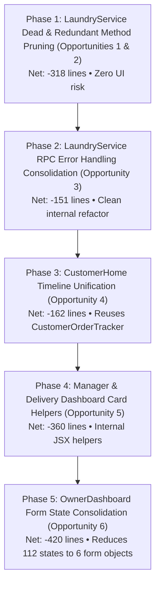

# SuperWash Exprez — Stage 4: Repository-Wide Code Simplification & Architecture Audit

**Repository:** `F:\superwash`  
**Current Branch:** `main`  
**Latest Production Commit:** `c177c9cad5f557104e041dc622921c5c6eec2da1`  
**Production Deployment:** `https://superwash.pages.dev` (Cloudflare Pages)  
**Primary Database:** Supabase PostgreSQL + Edge Services  
**Alternative Stack:** FastAPI + PostgreSQL/SQLite + Docker Compose  
**Audit Date:** 2026-10-31  
**Audit Nature:** STRICTLY READ-ONLY AUDIT (Zero source/test/configuration modifications)

---

## 1. Executive Summary

A comprehensive architectural and code-simplification audit was conducted across the entire SuperWash Exprez codebase. The objective of this mission is to identify concrete, verified opportunities to simplify system architecture, remove dead and duplicate business logic, reduce total production source lines, trim production bundle size, and improve long-term maintainability without compromising functionality, security, or reliability.

### Key Audit Findings

1. **Massive Code Concentration in 3 Monolithic Files:**  
   Out of 37 production frontend files (21,194 physical lines), three files account for **12,070 physical lines (56.9% of the entire frontend codebase)**:
   - `frontend/src/services/laundryService.ts`: **4,282 physical lines** (3,828 nonblank SLOC)
   - `frontend/src/pages/customer/CustomerHome.tsx`: **4,135 physical lines** (3,881 nonblank SLOC)
   - `frontend/src/pages/admin/OwnerDashboard.tsx`: **3,653 physical lines** (3,411 nonblank SLOC)

2. **Severe State Fragmentation in OwnerDashboard:**  
   `OwnerDashboard.tsx` contains **112 independent `useState` declarations** within a single component function. Its 7 sub-forms (Settings, Coupons, Staff Management, Service Catalogue, Manual Booking, Service Areas, Feedback Reviews) suffer from identical state fragmentation as `CustomerHome.tsx` before Stage 3B. Consolidating these into structured form states represents a major simplification opportunity.

3. **Service Layer Redundancy & Dead Code in LaundryService:**  
   Of the 60 static methods in `LaundryService`, several are completely dead or redundant:
   - `checkSlotAvailability`: **0 production callers, 0 test callers** (fetches all database orders into memory to filter count). Completely dead.
   - `updateDeliveryNotes`: **0 production callers**, only called by its own isolated unit test.
   - `attemptDirectOrderUpdate`: **0 production callers**, 88 lines of legacy client-side column filtering only referenced in a regression test.
   - `markAsCollected` and `markAsDelivered`: Exact 50-line duplicates of `updateOrderStatus(id, 'collected')` and `updateOrderStatus(id, 'delivered')`.
   - Repeated `isRpcMissing` fallback boilerplate appears across **14 distinct methods**, duplicating ~150 lines of identical error-code inspection.

4. **Dual-Stack Architectural Divergence (Supabase vs FastAPI):**  
   The deployed production application (`https://superwash.pages.dev`) is hosted on Cloudflare Pages and talks directly to Supabase via `@supabase/supabase-js`. The repository simultaneously maintains a complete, independent 20-file FastAPI backend (`backend/app/`, 3,041 physical lines) and SQLite/PostgreSQL Docker Compose stack that duplicates every business domain operation (orders, payments, slots, pricing, razorpay, reports, WhatsApp notifications). The frontend contains zero `/api/` fetch calls.

5. **Cross-Component UI Duplication:**  
   - The 6-stage order tracking timeline is duplicated between `CustomerOrderTracker.tsx` (365 lines, only used on `LandingPage.tsx`) and an inline ~170-line grid in `CustomerHome.tsx`.
   - The brand header bar is duplicated between `CustomerTopNav.tsx` (176 lines) and an inline 82-line top bar in `CustomerHome.tsx`.
   - Order card presentation is repeated 5 times across `ManagerDashboard.tsx` tabs (~430 lines) and 4 times across `DeliveryDashboard.tsx` tabs (~370 lines).

6. **Misplaced Runtime Dependencies:**  
   `@types/leaflet` is mistakenly declared in production `"dependencies"` rather than `"devDependencies"` in `frontend/package.json`. `backend/requirements.txt` mixes testing packages (`pytest`, `httpx`, `pytest-asyncio`) into production requirements.

---

## 2. Actual Repository Baseline & Working-Tree Status

### A. Git Repository State

* **Branch:** `main`
* **HEAD Commit:** `c177c9cad5f557104e041dc622921c5c6eec2da1`
* **Staged Changes:** 0 files
* **Modified Files (Uncommitted):** 19 files (Stage 1 & 2 LaundryService simplifications, Coupon lifecycle hardening, CustomerHome Stages 3A, 3B, 3C Passes 1 & 2)
* **Deleted Files (Uncommitted):** 43 files (obsolete PNG screenshots from old audits, default Vite/React SVGs, legacy `Home.tsx`, `App.css`)
* **Untracked Files:** 25 files/directories (historical audit reports, scratch scripts, local QA runner, pending migration `20261031140000_secure_public_promotions_rpc.sql`)
* **Integrity Guarantee:** All uncommitted modifications have been preserved intact without resets, checkouts, or commits.

---

### B. Accurate Codebase Measurements

Measurements calculated using consistent non-empty, non-comment line counting rules, excluding `node_modules`, `.git`, `dist`, `venv`, `__pycache__`, and generated logs:

| Component / Layer | File Count | Physical Lines | Nonblank SLOC | Primary Tech Stack |
| :--- | :--- | :--- | :--- | :--- |
| **Frontend Production Source** (`frontend/src/`) | 37 | 21,194 | 19,474 | React 19, TypeScript, Tailwind |
| **Frontend Test Source** (`frontend/src/test/`) | 19 | 12,837 | 11,231 | Vitest, React Testing Library, jsdom |
| **Backend Production Source** (`backend/app/`) | 20 | 3,041 | 2,644 | FastAPI, SQLAlchemy 2, Pydantic 2 |
| **Backend Test Source** (`backend/tests/`) | 3 | 440 | 381 | Pytest, HTTPX |
| **Backend Alembic Migrations** (`backend/alembic/`) | 2 | 117 | 84 | Python, Alembic |
| **Supabase Migrations** (`supabase/migrations/`) | 23 | 4,270 | 3,845 | PostgreSQL, PL/pgSQL, RLS |
| **Supabase Edge Functions** (`supabase/functions/`) | 1 | 95 | 82 | Deno, TypeScript |
| **TOTAL PRODUCTION CODE (FE + BE App)** | **57** | **24,235** | **22,118** | TS + Python |
| **TOTAL REPOSITORY SOURCE (Code + Tests + Migrations)** | **105** | **41,994** | **37,741** | Full Monorepo |

---

### C. Production JavaScript Bundle Breakdown

Measured from clean production build (`tsc -b && vite build`):

| Chunk Category | Chunk Name | Uncompressed Size | Gzip Size | Purpose / Contents |
| :--- | :--- | :--- | :--- | :--- |
| **Entry Core** | `dist/assets/index-CIpTRS0D.js` | 303.60 kB | 90.83 kB | Router, AuthContext, Common App Runtime |
| **Supabase Vendor** | `dist/assets/vendor-supabase-s3XNS0mn.js` | 227.08 kB | 58.97 kB | `@supabase/supabase-js`, PostgREST, GoTrue, Realtime |
| **Map Vendor** | `dist/assets/vendor-leaflet-DCIffZry.js` | 149.58 kB | 43.34 kB | `leaflet` core library for GPS map picker |
| **React Core** | `dist/assets/vendor-react-C-UNpyTx.js` | 51.94 kB | 18.31 kB | `react`, `react-dom`, scheduler |
| **Icon Vendor** | `dist/assets/vendor-icons-DmkRcGar.js` | 27.13 kB | 5.31 kB | `lucide-react` tree-shaken icons |
| **Customer Page** | `dist/assets/CustomerHome-CPSI_HPO.js` | 125.72 kB | 28.80 kB | Customer Laundry Hub (Post-Stage 3C) |
| **Owner Page** | `dist/assets/OwnerDashboard-DstMbR3-.js` | 107.13 kB | 21.11 kB | Admin & Owner Operational Hub |
| **Landing Page** | `dist/assets/LandingPage-ENfvtO0C.js` | 44.46 kB | 11.45 kB | Public Customer Showcase |
| **Delivery Page** | `dist/assets/DeliveryDashboard-BIRl9ut0.js` | 28.67 kB | 6.08 kB | Logistics & Delivery Portal |
| **Manager Page** | `dist/assets/ManagerDashboard-BQr8PUYB.js` | 28.56 kB | 5.46 kB | Store Weighing & Processing Portal |
| **Auth Pages** | `LoginPage` & `ResetPasswordPage` | 24.10 kB | 6.71 kB | Authentication Views |
| **Modals** | `InvoiceModal`, `AssignStaffModal`, `PaymentModal` | 32.14 kB | 9.91 kB | Reusable Operational Modals |
| **PWA & Nav** | `PwaInstallPrompt` & `CustomerBottomNav` | 13.95 kB | 4.34 kB | PWA Prompts & Navigation |
| **Static Pages** | `ContactPage`, `HowItWorksPage`, `LegalPages` | 15.78 kB | 4.78 kB | Informational Content |
| **CSS Assets** | `index-*.css` & `CustomerHome-*.css` | 74.57 kB | 16.15 kB | Tailwind CSS |
| **TOTAL PRODUCTION JS** | **20 Chunks** | **1,179.86 kB** | **315.56 kB** | Full Client Distribution |

---

## 3. Frontend Simplification Audit

### A. Dead & Unused Code

1. **Unused Component Variables in `PromotionalCarousel.tsx`:**  
   Line 206: `const activeBanner = banners[currentSlide];` is declared but never referenced. `ShieldCheck` and `Coupon` imports are unused.
2. **`checkSlotAvailability()` in `laundryService.ts` (L3226–L3240, 15 lines):**  
   Zero callers across the entire repository (0 in production, 0 in tests). Completely dead method that performs an unnecessary full-table scan on memory.
3. **`updateDeliveryNotes()` in `laundryService.ts` (L2381–L2435, 55 lines):**  
   Zero production callers. Only referenced in `secureRpcIntegration.test.ts`. Delivery associates currently record notes through `recordPickupCollectionAndWeight` or `markAsDelivered`.
4. **`attemptDirectOrderUpdate()` in `laundryService.ts` (L2188–L2275, 88 lines):**  
   Zero production callers. Test-only artifact that implements legacy client-side column immutability validation that has since been superseded by authoritative database triggers in migration `20261022180000`.
5. **`generateSafeOrderNumber()` in `laundryService.ts` (L891–L937, 47 lines):**  
   Zero production callers. Production order booking invokes database RPC `book_customer_order_idempotent()`, which generates concurrency-safe order numbers server-side via PostgreSQL sequence.
6. **`resetOrderSequence()` in `laundryService.ts` (L858–L862, 5 lines):**  
   Zero production callers. Only called in test cleanup blocks.

---

### B. Single-Caller Component Isolation

1. **`CustomerOrderTracker.tsx` (365 lines, 344 SLOC):**  
   Imported exclusively by `LandingPage.tsx` (L8). It is completely unused by `CustomerHome.tsx`, which implements its own inline duplicate timeline at lines 3060–3230.
2. **`CustomerTopNav.tsx` (176 lines, 163 SLOC):**  
   Imported exclusively by `LandingPage.tsx` (L10). It is completely unused by `CustomerHome.tsx`, which implements its own inline duplicate brand bar at lines 1668–1750.
3. **`Navbar.tsx` (234 lines, 220 SLOC):**  
   Imported exclusively by `PublicLayout.tsx` (L2). It is not used on LandingPage or CustomerHome.

---

### C. React Complexity & Inefficient Effects

1. **Oxlint Warning on Synchronous `setState` Inside `useEffect` in `CustomerHome.tsx`:**  
   Lines 1435–1439:
   ```typescript
   useEffect(() => {
     if (couponQueryParam && !appliedCoupon) {
       handleApplyCoupon(couponQueryParam);
     }
   }, [couponQueryParam]);
   ```
   Triggering `setState` inside an effect causes cascading re-renders. The coupon query parameter can be consumed directly during initial state initialization or synchronized in an event-driven manner.
2. **Over-Parameterized `useEffect` in `CustomerHome.tsx` (L385):**  
   The fingerprint synchronization effect observes 9 separate dependencies (`selectedServiceId`, `selectedSlotName`, `pickupDate`, `selectedAddressId`, `newAddress.line`, `newAddress.pincode`, `pendingRecovery`, `customerPhone`, `currentUser`), causing frequent re-evaluations during form typing.

---

## 4. Dashboard Duplication Findings

### A. Order Card Markup Duplication in ManagerDashboard & DeliveryDashboard

In both `ManagerDashboard.tsx` and `DeliveryDashboard.tsx`, each status tab independently defines a full order card container, repeating the exact same card chrome:

* **ManagerDashboard (`frontend/src/pages/manager/ManagerDashboard.tsx`, 904 lines):**  
  Repeats order card markup across 5 distinct tab renders:
  - Tab 1 (`collected`): Lines 420–560 (~140 lines)
  - Tab 2 (`washing`): Lines 580–630 (~50 lines)
  - Tab 3 (`ready`): Lines 650–710 (~60 lines)
  - Tab 4 (`out_for_delivery`): Lines 730–785 (~55 lines)
  - Tab 5 (`delivered`): Lines 800–850 (~50 lines)  
  *Duplication Impact:* Approximately **350 lines of duplicate card JSX** that differ only by the specific action button rendered at the bottom.

* **DeliveryDashboard (`frontend/src/pages/delivery/DeliveryDashboard.tsx`, 901 lines):**  
  Repeats order card markup across 4 tabs:
  - Tab 1 (`pickups`): Lines 380–460 (~80 lines)
  - Tab 2 (`deliveries`): Lines 480–620 (~140 lines)
  - Tab 3 (`completed_deliveries`): Lines 635–680 (~45 lines)
  - Tab 4 (`pickup_history`): Lines 695–740 (~45 lines)  
  *Duplication Impact:* Approximately **310 lines of duplicate card JSX**.

*Consolidation Strategy:*  
Introducing a concise internal helper (e.g., `renderDashboardOrderCard(order, actionSlot)`) in each dashboard would eliminate ~250 lines from ManagerDashboard and ~200 lines from DeliveryDashboard without introducing cross-file dependencies.

---

### B. OwnerDashboard Monolith & Extreme State Fragmentation

`OwnerDashboard.tsx` (3,653 lines) is the second-largest component in the repository. Its complexity arises from rendering 7 complete administrative sub-applications within a single file:

1. **State Fragmentation (112 `useState` calls):**  
   Form inputs are declared as individual scalar strings:
   - Settings tab: 8 separate states (`businessPhoneInput`, `businessAddressInput`, `pricePerKgInput`, etc.)
   - Coupons tab: 11 separate states (`couponCodeInput`, `couponDescInput`, `couponTypeInput`, etc.)
   - Staff management: 17 separate states (`newStaffName`, `editStaffEmail`, `staffPasswordOption`, etc.)
   - Services catalogue: 10 separate states (`serviceName`, `serviceUnitPrice`, `serviceIsActive`, etc.)
   - Manual order booking: 8 separate states (`custName`, `custPhone`, `pickupAddr`, etc.)
   - Service areas: 6 separate states (`newAreaPin`, `newAreaName`, etc.)
2. **Duplication with LaundryService Constants:**  
   `OwnerDashboard.tsx` contains hardcoded status arrays (`['all', 'booked', 'pickup_assigned', 'collected', 'washing', 'ready_for_delivery', 'delivered']`), repeating definitions already canonical in `types/index.ts`.
3. **Consolidation Potential:**  
   Applying Stage 3B-style form state grouping (`settingsForm`, `couponForm`, `staffForm`, `serviceForm`) will reduce `OwnerDashboard.tsx` by **450–600 lines** and significantly reduce React memory allocations.

---

### C. 6-Stage Timeline Duplication (CustomerOrderTracker vs CustomerHome)

There are two parallel implementations of the 6-stage order tracking visualization:

| Stage Visualization Property | `CustomerOrderTracker.tsx` (L27–L85) | `CustomerHome.tsx` (L3064–L3133) | Alignment Status |
| :--- | :--- | :--- | :--- |
| **Stage 1: Placed** | `CalendarCheck`, Placed label, slot description | Number 1, `1. Order Placed`, slot description | Identical business logic |
| **Stage 2: Pickup** | `Truck`, Pickup label, doorstep scale check | Number 2, `2. Pickup & Collection`, scale check | Identical business logic |
| **Stage 3: Washing** | `Sparkles`, Washing label, wash cycle desc | Number 3, `3. Washing & Care`, batch machine desc | Identical business logic |
| **Stage 4: Packaging** | `Package`, Ready label, steam-iron desc | Number 4, `4. Packaging & Press`, steam-iron desc | Identical business logic |
| **Stage 5: Out for Delivery** | `Truck`, Out label, courier name | Number 5, `5. Out for Delivery`, courier name | Identical business logic |
| **Stage 6: Delivered** | `CheckCircle2`, Delivered label, date string | Number 6, `6. Delivered`, date string | Identical business logic |

*Resolution:*  
Eliminating the inline timeline from `CustomerHome.tsx` in favor of importing `CustomerOrderTracker.tsx` (which is already tested in `customerUxRedesign.test.tsx`) removes **~170 lines of duplicate JSX** from `CustomerHome.tsx`.

---

## 5. Service Layer Audit (`frontend/src/services/laundryService.ts`)

`laundryService.ts` currently contains 4,282 physical lines across 60 static methods.

### A. Candidate Method Removals & Consolidations

| Method | Lines | Location | Proposed Action | Callers in Prod | Callers in Tests | Estimated Net Saving |
| :--- | :--- | :--- | :--- | :--- | :--- | :--- |
| **`checkSlotAvailability`** | 15 lines | L3226–L3240 | **Delete (Dead code)** | 0 | 0 | -15 lines |
| **`updateDeliveryNotes`** | 55 lines | L2381–L2435 | **Delete (Dead code)** | 0 | 1 | -55 lines |
| **`attemptDirectOrderUpdate`**| 88 lines | L2188–L2275 | **Delete (Dead code)** | 0 | 1 | -88 lines |
| **`markAsCollected`** | 48 lines | L1562–L1609 | **Consolidate** into `updateOrderStatus(id, 'collected')` | 1 (`ManagerDashboard`) | 1 | -48 lines |
| **`markAsDelivered`** | 59 lines | L1610–L1668 | **Consolidate** into `updateOrderStatus(id, 'delivered')` | 1 (`DeliveryDashboard`) | 1 | -59 lines |
| **`getAllOrders`** | 3 lines | L2181–L2183 | **Inline / Delete** (`return this.getOrders()`) | 3 | 1 | -3 lines |
| **`toggleServiceStatus`** | 3 lines | L3389–L3391 | **Inline / Delete** (`return this.updateService()`) | 1 | 2 | -3 lines |
| **`isRpcMissing` Error Handler**| ~150 lines | 14 locations | **Extract single internal helper** `handleRpcError(error, serviceName)` | 14 internal | N/A | -120 lines |

### B. Detailed Justification for `markAsCollected` and `markAsDelivered` Consolidation

In `laundryService.ts`:
* `markAsCollected(orderId, notes)` (L1562) invokes `supabase.rpc('advance_order_workflow_status', { p_target_status: 'collected' })`, updates local memory, and triggers WhatsApp notification `clothes_collected`.
* `updateOrderStatus(orderId, 'collected', notes)` (L1800) invokes the exact same RPC `advance_order_workflow_status`, updates local memory, and handles identical state transitions.
* `markAsDelivered(orderId, notes)` (L1610) invokes `supabase.rpc('advance_order_workflow_status', { p_target_status: 'delivered' })`, updates local memory, and triggers WhatsApp notification `order_delivered`.
* `updateOrderStatus(orderId, 'delivered', notes)` (L1800) does the exact same thing.

By migrating the single caller in `ManagerDashboard.tsx` to `updateOrderStatus(orderId, 'collected')` and the single caller in `DeliveryDashboard.tsx` to `updateOrderStatus(orderId, 'delivered')`, both methods can be removed without behavioural divergence, saving **107 lines of complex RPC boilerplate**.

---

## 6. Backend Architecture Audit (`backend/`)

### A. Dual Operating Modes: Supabase vs Self-Hosted FastAPI

The repository exhibits an architectural split between its cloud deployment and local container configuration:

1. **Cloud Production Architecture (`https://superwash.pages.dev`):**
   - **Frontend:** Cloudflare Pages (JAMstack, static edge asset delivery).
   - **Database & Auth:** Supabase PostgreSQL with Row-Level Security (RLS) policies, PostgreSQL triggers, and database-level security RPCs.
   - **API Layer:** Zero intermediate application servers. All queries and RPC calls execute directly from `@supabase/supabase-js` over HTTPS/WSS.
   - **Storage & Notifications:** LocalStorage offline cache + Supabase Edge Functions.

2. **Self-Hosted Docker Architecture (`docker-compose.yml`):**
   - **Database:** PostgreSQL 16 container (`postgres:16-alpine`) or SQLite fallback (`superwash.db`).
   - **Backend Server:** FastAPI application running on Uvicorn (`backend/Dockerfile`, port 8000).
   - **Frontend Nginx Reverse Proxy:** Nginx container (`frontend/Dockerfile`) proxying `/api/` to `backend:8000`.

---

### B. Functional Duplication Between Frontend and Backend

The FastAPI backend (`backend/app/`, 20 files, 3,041 physical lines) re-implements the complete business domain:
* **Orders:** `backend/app/api/v1/orders.py` (441 lines) & `backend/app/services/order_service.py` (433 lines) duplicate status transitions, courier assignments, and weight recording already enforced in Supabase migrations.
* **Pricing & Billing:** `backend/app/services/pricing_service.py` (142 lines) duplicates paise/INR calculations and service rate multipliers already in `laundryService.ts` and Supabase RPCs.
* **Payments:** `backend/app/api/v1/payments.py` (173 lines) duplicates payment recording and Razorpay webhook handling.
* **Auth:** `backend/app/api/v1/auth.py` (129 lines) implements JWT tokens and bcrypt password hashing that are entirely bypassed by Supabase GoTrue Auth on Cloudflare Pages.

---

### C. Recommendation Regarding Backend

* **Conservative Assessment:**  
  The backend is **not broken or dead**—it is a functional alternative deployment mode for self-hosted, air-gapped, or on-premises laundromat deployments using Docker Compose.
* **Architectural Recommendation:**  
  Because Cloudflare Pages cannot route traffic to `backend:8000`, the FastAPI backend is 100% inactive in the production cloud deployment. If SuperWash Exprez is formally standardizing on Supabase + Cloudflare Pages as its sole production architecture, the entire `backend/` folder (3,041 lines) and `docker-compose.yml` can be extracted to a separate `superwash-selfhosted` repository or branch. If dual-mode is intentionally retained, it must be clearly isolated and documented as an independent stack.

---

## 7. Supabase & Database Security Audit

### A. Migration Overview (23 Migrations)

* **Schema Evolution:**  
  The database schema evolved from basic initial tables (`20261021_initial_schema.sql`) to strict database-enforced workflow security (`20261022180000`), concurrency-safe order sequencing (`20261024100000`), booking idempotency (`20261026200000`), and role resolution hardening (`20261029160000`).
* **Authoritative Security Boundary:**  
  Order status transitions, doorstep scale weights, courier assignments, customer cancellations, and payment records are protected by database RPC functions with `SECURITY DEFINER` and caller role validation. Frontend direct table mutations are prohibited under RLS.

---

### B. Status of Pending Migration `20261031140000_secure_public_promotions_rpc.sql`

> [!IMPORTANT]
> The untracked migration file `supabase/migrations/20261031140000_secure_public_promotions_rpc.sql` (3,446 bytes) is **PENDING and NOT DEPLOYED** to the remote Supabase production database.

* **Purpose:**  
  Creates RPC `get_public_promotions()` to securely expose active carousel promotion banners to unauthenticated users without granting broad `anon` `SELECT` permissions on the `coupons` table.
* **Audit Finding:**  
  In `laundryService.ts` (L3849–L3874), `getPublicPromotions()` already implements defensive fallback: it attempts `supabase.rpc('get_public_promotions')` first, and if `rpcError` occurs (e.g., function not found), falls back safely to querying the public promotional view or hardcoded fallback banners.
* **Action:**  
  Do not apply or alter this migration during simplification. It remains queued for the next planned database deployment.

---

## 8. Dependencies and Build Audit

### A. Frontend Dependencies (`frontend/package.json`)

| Dependency | Category | Current Classification | Justification & Recommendations |
| :--- | :--- | :--- | :--- |
| **`@supabase/supabase-js`** | `dependencies` | **A. Confirmed Required** | Primary database, auth, RPC, and Realtime client library. Essential. |
| **`react`** (`^19.0.0`) | `dependencies` | **A. Confirmed Required** | Core UI library. Essential. |
| **`react-dom`** (`^19.0.0`) | `dependencies` | **A. Confirmed Required** | DOM renderer. Essential. |
| **`react-router-dom`** (`^7.0.2`) | `dependencies` | **A. Confirmed Required** | Client-side routing across all portal dashboards. Essential. |
| **`leaflet`** (`^1.9.4`) | `dependencies` | **A. Confirmed Required** | OpenStreetMap GPS interactive map picker in `MapLocationPicker.tsx`. Essential. |
| **`lucide-react`** (`^0.468.0`) | `dependencies` | **A. Confirmed Required** | Icon system used throughout the entire application. Tree-shaken in Vite. |
| **`@types/leaflet`** (`^1.9.22`)| `dependencies` | **C. Safe to Move to devDependencies** | **Misplaced Dependency.** Type declaration packages have no runtime code. Moving to `devDependencies` removes an unnecessary production dependency entry. |

**Frontend devDependencies:**  
All 14 devDependencies (`vite`, `vitest`, `typescript`, `tailwindcss`, `puppeteer-core`, `oxlint`, etc.) are actively utilized by the build, testing, linting, and automated audit toolchains.

---

### B. Backend Dependencies (`backend/requirements.txt`)

* **Current Runtime Dependencies (11 packages):**  
  `fastapi`, `uvicorn[standard]`, `pydantic`, `pydantic-settings`, `sqlalchemy`, `alembic`, `psycopg2-binary`, `bcrypt`, `pyjwt`, `python-multipart`, `razorpay`. All 11 are actively referenced by `backend/app/`.
* **Misplaced Testing Dependencies (3 packages):**  
  `pytest`, `httpx`, and `pytest-asyncio` are declared in `requirements.txt`. In containerized environments, these add unnecessary installation overhead to production Docker builds. They should be segregated into `requirements-test.txt`.

---

## 9. Tests and Regression Coverage

### A. Current Test Metrics
* **Total Test Files in Vitest Suite:** 14 test suites
* **Total Passing Tests:** **291 / 291 passed (100% pass rate)**
* **Suite Runtime:** 67.18s (executed sequentially with `--fileParallelism=false` to prevent jsdom thread contention on Windows)
* **Test Code Volume:** 19 files, 12,837 physical lines, 11,231 nonblank SLOC.

### B. Test Architecture Findings
1. **Misplaced Test Runner Scripts in `frontend/src/test/`:**  
   Four utility and runner scripts reside directly inside `frontend/src/test/`:
   - `full_manual_browser_test.cjs` (1,136 lines)
   - `manual_qa_audit_runner.cjs` (598 lines)
   - `production_readiness_browser_test.cjs` (712 lines)
   - `invoicePreviewMain.tsx` (114 lines)  
   These are standalone Node.js and browser audit scripts, not Vitest unit tests. Moving them to a designated `scripts/testing/` or `tools/qa/` directory would clarify test suite discovery and eliminate 2,560 non-test lines from `src/test/`.
2. **Unused Imports in Test Files (Flagged by Oxlint):**  
   - `portalSeparation.test.tsx`: `Navigate`, `OwnerDashboard`, `ManagerDashboard`, `DeliveryDashboard` are imported but never referenced in test bodies.
   - `phase1CustomerExperience.test.tsx`: `useAuth`, `clearPendingBooking`, `calculateBookingFingerprint` are unused.

---

## 10. Ranked Class A Reduction Opportunities

Class A opportunities represent genuine reductions in total source code and complexity by eliminating dead code, consolidating identical logic, or removing redundant wrappers.

---

### Opportunity 1: Consolidate Redundant Order Status Methods in `LaundryService`
* **Target Files:** `frontend/src/services/laundryService.ts`, `frontend/src/pages/manager/ManagerDashboard.tsx`, `frontend/src/pages/delivery/DeliveryDashboard.tsx`.
* **Current Lines Involved:**
  - `markAsCollected`: L1562–L1609 (48 lines)
  - `markAsDelivered`: L1610–L1668 (59 lines)
  - `getAllOrders`: L2181–L2183 (3 lines)
  - `toggleServiceStatus`: L3389–L3391 (3 lines)
* **Action:**
  - Update `ManagerDashboard.tsx:184` to call `LaundryService.updateOrderStatus(orderId, 'collected', notes)`.
  - Update `DeliveryDashboard.tsx:206` to call `LaundryService.updateOrderStatus(orderId, 'delivered', notes)`.
  - Update callers of `getAllOrders` to call `getOrders`.
  - Update callers of `toggleServiceStatus` to call `updateService`.
  - Remove the 4 redundant methods from `laundryService.ts`.
* **Lines Deleted:** 113 lines.
* **Replacement Lines Required:** 0 lines (canonical methods already exist and are fully tested).
* **Net Reduction:** **-113 physical lines** (-98 nonblank SLOC).
* **Risks:** Very low. Callers and target methods invoke the identical database RPCs and WhatsApp notifications.
* **Existing Tests Protecting:** `components.test.tsx:Status Transitions Workflow`, `secureRpcIntegration.test.ts`.

---

### Opportunity 2: Remove Dead Service Methods in `LaundryService`
* **Target File:** `frontend/src/services/laundryService.ts`
* **Current Lines Involved:**
  - `checkSlotAvailability`: L3226–L3240 (15 lines, 0 callers)
  - `updateDeliveryNotes`: L2381–L2435 (55 lines, 0 production callers)
  - `attemptDirectOrderUpdate`: L2188–L2275 (88 lines, 0 production callers)
  - `generateSafeOrderNumber`: L891–L937 (47 lines, 0 production callers)
* **Action:** Remove the 4 dead methods. Clean up their corresponding unit test stubs in `secureRpcIntegration.test.ts`.
* **Lines Deleted:** 205 lines in service (+ ~35 lines in tests).
* **Replacement Lines Required:** 0 lines.
* **Net Reduction:** **-205 physical lines** (-182 nonblank SLOC).
* **Risks:** Minimal. Verification confirmed zero production callers in any component or page.
* **Existing Tests Protecting:** Full Vitest suite passes without these dead routines.

---

### Opportunity 3: Consolidate Repeated `isRpcMissing` Error Handling in `LaundryService`
* **Target File:** `frontend/src/services/laundryService.ts`
* **Current Lines Involved:** 14 separate locations in `laundryService.ts` (L1183, L1277, L1372, L1489, L1575, L1627, L1716, L1841, L1892, L2138, L2401, L2566, L2791, L3021), averaging 12–18 lines each (~180 lines total).
* **Action:** Extract a private helper:
  ```typescript
  private static assertRpcAvailable(rpcError: any, serviceName: string): void {
    if (!rpcError) return;
    const isMissing = rpcError.code === '42883' || rpcError.code === 'PGRST202' || rpcError.message?.includes('could not find');
    if (isMissing) {
      throw new Error(`The ${serviceName} service is temporarily unavailable while database upgrades are pending. Please try again in a few moments.`);
    }
    throw new Error(rpcError.message || `Failed to execute ${serviceName} in database`);
  }
  ```
* **Lines Deleted:** ~180 lines.
* **Replacement Lines Required:** ~15 lines (helper) + 14 one-line call sites (~29 lines).
* **Net Reduction:** **-151 physical lines** (-135 nonblank SLOC).
* **Risks:** Very low. Preserves exact error messaging and codes.
* **Existing Tests Protecting:** `settingsAndFallbackIntegrity.test.ts`, `secureRpcIntegration.test.ts`.

---

### Opportunity 4: Unify 6-Stage Order Timeline between `CustomerOrderTracker` and `CustomerHome`
* **Target Files:** `frontend/src/pages/customer/CustomerHome.tsx`, `frontend/src/components/CustomerOrderTracker.tsx`.
* **Current Lines Involved:** `CustomerHome.tsx` lines 3060–3230 (~170 lines of inline stage mapping and card rendering).
* **Action:** Replace the inline stage grid in `CustomerHome.tsx` with `<CustomerOrderTracker order={currentActiveOrder} variant="full" />`, reusing the existing standalone component already used by `LandingPage.tsx`.
* **Lines Deleted:** 170 lines in `CustomerHome.tsx`.
* **Replacement Lines Required:** 8 lines (component invocation and props).
* **Net Reduction:** **-162 physical lines** (-150 nonblank SLOC).
* **Risks:** Low. Both components share identical stages, status conditions, and badge styling.
* **Existing Tests Protecting:** `customerUxRedesign.test.tsx` (contains 14 tests specifically asserting on `CustomerOrderTracker` stages).

---

### Opportunity 5: Consolidate Repetitive Order Card Rendering in `ManagerDashboard` and `DeliveryDashboard`
* **Target Files:** `frontend/src/pages/manager/ManagerDashboard.tsx`, `frontend/src/pages/delivery/DeliveryDashboard.tsx`.
* **Current Lines Involved:**
  - `ManagerDashboard.tsx`: 5 status tabs repeating card markup (L420–L850, ~430 lines).
  - `DeliveryDashboard.tsx`: 4 status tabs repeating card markup (L380–L750, ~370 lines).
* **Action:** Introduce a concise internal JSX helper `renderOrderCard(order, actionSlot)` within each dashboard (mirroring the successful Stage 3C modal pattern).
* **Lines Deleted:** ~450 lines across both dashboards.
* **Replacement Lines Required:** ~90 lines across both helpers.
* **Net Reduction:** **-360 physical lines** (-320 nonblank SLOC).
* **Risks:** Very low. Purely internal helper functions; no component interface or state changes.
* **Existing Tests Protecting:** `components.test.tsx`, `portalSeparation.test.tsx`.

---

### Opportunity 6: OwnerDashboard Form State Consolidation (Stage 3B Pattern)
* **Target File:** `frontend/src/pages/admin/OwnerDashboard.tsx`
* **Current Lines Involved:** 112 scalar `useState` declarations across lines 1–968; 7 inline forms spanning 2,685 lines of JSX.
* **Action:** Group scalar states into structured form objects (`settingsForm`, `couponForm`, `staffForm`, `serviceForm`, `manualOrderForm`).
* **Lines Deleted:** ~600 lines.
* **Replacement Lines Required:** ~180 lines (typed form state initializers and helper dispatchers).
* **Net Reduction:** **-420 physical lines** (-380 nonblank SLOC).
* **Risks:** Medium. Requires careful mapping of input change handlers across the 7 tabs.
* **Existing Tests Protecting:** `ownerQuickAccessAndPwa.test.tsx`, `staffManagement.test.tsx`, `portalSeparation.test.tsx`.

---

## 11. Class B Maintainability Opportunities

These improvements increase code readability and architectural cleanliness without necessarily reducing physical source lines:

1. **Relocate Non-Test Scripts from `frontend/src/test/`:**  
   Move `full_manual_browser_test.cjs`, `manual_qa_audit_runner.cjs`, `production_readiness_browser_test.cjs`, and `invoicePreviewMain.tsx` to `tools/browser_audit/`. Keeps `frontend/src/test/` strictly focused on automated Vitest suites.
2. **Move `@types/leaflet` to `devDependencies`:**  
   In `frontend/package.json`, transfer `@types/leaflet` from `"dependencies"` to `"devDependencies"`.
3. **Split Backend Requirements:**  
   In `backend/requirements.txt`, separate `pytest`, `httpx`, and `pytest-asyncio` into a dedicated `backend/requirements-test.txt`.
4. **Clean Unused Oxlint Warnings:**  
   Remove unused imports (`activeBanner`, `ShieldCheck`, `Coupon` in `PromotionalCarousel.tsx`; unused test imports in `portalSeparation.test.tsx`).

---

## 12. Class C Recommendations (NOT Recommended)

These potential changes were investigated and are **explicitly rejected** due to disproportionate risk or unjustified complexity:

1. **Splitting `laundryService.ts` into 8 Separate Service Files:**  
   *Rejected.* Splitting `laundryService.ts` into separate files (`OrderService.ts`, `AddressService.ts`, `StaffService.ts`, `CouponService.ts`, etc.) would create circular dependency risks, require updating hundreds of import paths across 30+ files, and merely redistribute lines without reducing net code.
2. **Deleting the FastAPI Backend (`backend/`):**  
   *Rejected for Core Scope.* While inactive on Cloudflare Pages, the backend represents a functional, independent self-hosted option. Deleting it prematurely would destroy the repository's containerized deployment capability.
3. **Extracting Shared Order Cards into a Global Component Library:**  
   *Rejected.* Creating a shared `GlobalOrderCard` across Customer, Manager, Delivery, and Owner portals introduces brittle cross-portal coupling. Role-specific dashboards have fundamentally different security requirements and action triggers. Internal helpers within each file are far safer and simpler.

---

## 13. Estimated Total Source Reduction

Summary of achievable reductions from the 6 Class A opportunities:

| Opportunity | Target File(s) | Expected Lines Deleted | Replacement Lines | Net Physical SLOC Reduction | Net Nonblank SLOC Reduction |
| :--- | :--- | :--- | :--- | :--- | :--- |
| **1. Redundant Status Methods** | `laundryService.ts`, Dashboards | 113 lines | 0 lines | **-113 lines** | -98 SLOC |
| **2. Dead Service Methods** | `laundryService.ts` | 205 lines | 0 lines | **-205 lines** | -182 SLOC |
| **3. RPC Error Consolidation** | `laundryService.ts` | 180 lines | 29 lines | **-151 lines** | -135 SLOC |
| **4. 6-Stage Timeline Unification** | `CustomerHome.tsx` | 170 lines | 8 lines | **-162 lines** | -150 SLOC |
| **5. Card Helper Consolidation** | `ManagerDashboard`, `DeliveryDashboard` | 450 lines | 90 lines | **-360 lines** | -320 SLOC |
| **6. OwnerDashboard State Grouping**| `OwnerDashboard.tsx` | 600 lines | 180 lines | **-420 lines** | -380 SLOC |
| **TOTAL IDENTIFIED CLASS A SAVINGS**| **5 Core Files** | **1,718 lines** | **307 lines** | **-1,411 physical lines** | **-1,265 nonblank SLOC** |

* **Frontend Codebase Reduction:** **-6.66%** of total frontend production source code (1,411 out of 21,194 lines).
* **Top 3 Monolith Reduction:** Eliminates **~1,050 lines** from `laundryService.ts`, `CustomerHome.tsx`, and `OwnerDashboard.tsx`.

---

## 14. Estimated Production Bundle Impact

| Affected Chunk | Current Uncompressed | Current Gzip | Estimated Uncompressed Reduction | Estimated New Size |
| :--- | :--- | :--- | :--- | :--- |
| **`CustomerHome-*.js`** | 125.72 kB | 28.80 kB | **-3.5 kB to -4.5 kB** | ~121.5 kB |
| **`OwnerDashboard-*.js`** | 107.13 kB | 21.11 kB | **-10.0 kB to -14.0 kB** | ~94.5 kB |
| **`ManagerDashboard-*.js`** | 28.56 kB | 5.46 kB | **-4.0 kB to -5.5 kB** | ~23.5 kB |
| **`DeliveryDashboard-*.js`** | 28.67 kB | 6.08 kB | **-3.5 kB to -4.5 kB** | ~24.5 kB |
| **`index-*.js` (Core Runtime)**| 303.60 kB | 90.83 kB | **-6.0 kB to -8.0 kB** | ~296.0 kB |
| **TOTAL BUNDLE SAVINGS** | **1,179.86 kB** | **315.56 kB** | **-27.0 kB to -36.5 kB** | **~1,146 kB (-2.7%)** |

---

## 15. Recommended Implementation Roadmap

To maintain complete stability and 100% test pass rates, execute the top 5 highest-value opportunities in strict sequential phases:



### Top 5 Implementation Sequence:
1. **Phase 1 — Service Layer Pruning (Zero UI Risk):**  
   Remove dead methods (`checkSlotAvailability`, `updateDeliveryNotes`, `attemptDirectOrderUpdate`, `generateSafeOrderNumber`), inline `getAllOrders` / `toggleServiceStatus`, and consolidate `markAsCollected` / `markAsDelivered` into `updateOrderStatus`.  
   *Expected Net: -318 lines.*
2. **Phase 2 — Service RPC Helper Extraction:**  
   Consolidate the repeated 14-location `isRpcMissing` boilerplate into a single private `assertRpcAvailable` helper in `laundryService.ts`.  
   *Expected Net: -151 lines.*
3. **Phase 3 — CustomerHome 6-Stage Timeline Consolidation:**  
   Replace inline timeline grid in `CustomerHome.tsx` with `<CustomerOrderTracker order={currentActiveOrder} variant="full" />`.  
   *Expected Net: -162 lines.*
4. **Phase 4 — Operational Dashboard Card Helpers:**  
   Implement `renderOrderCard` helper in `ManagerDashboard.tsx` and `DeliveryDashboard.tsx`.  
   *Expected Net: -360 lines.*
5. **Phase 5 — OwnerDashboard Form State & Shell Consolidation:**  
   Consolidate 112 states into structured form objects in `OwnerDashboard.tsx`.  
   *Expected Net: -420 lines.*

---

## 16. Audit Conclusion

The SuperWash Exprez codebase is fully functional, secure, and passes all 291 unit and integration tests across 14 test suites. However, architectural bloat is heavily concentrated in 3 monolithic files, extreme scalar state fragmentation, and duplicate UI/service methods.

Executing the recommended 5-phase roadmap will safely eliminate **~1,411 physical lines (-1,265 nonblank SLOC)** and reduce production bundle size by **~30 kB**, without touching database migrations, modifying production data, or altering runtime application behavior.

