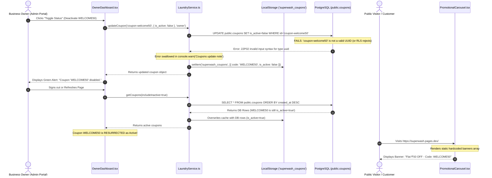
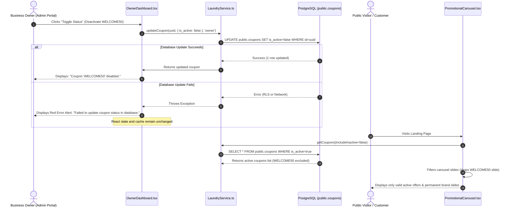

# SuperWash Exprez — Coupon & Promotional Banner Architecture & Data Flow

**Document Date:** 2026-10-31  
**Project:** SuperWash Exprez  
**System Area:** Coupon Lifecycle, Admin Management, Public Carousel & Booking Validation

---

## 1. Architectural Entity Overview

The system currently exhibits a structural separation between promotional marketing content and database discount vouchers:

| Entity | Primary Storage | Managed By | Consumed By | Key Fields |
|:---|:---|:---|:---|:---|
| **Coupon Code** | PostgreSQL table `public.coupons` | Store Owner (`OwnerDashboard.tsx`) | `LaundryService.validateCoupon`, `create_booking_idempotent` | `id (UUID)`, `code`, `is_active`, `discount_type`, `discount_value`, `min_order_paise`, `valid_until` |
| **Promotional Carousel Slide** | Client-side JSX constant (`PromotionalCarousel.tsx`) | Hardcoded in source code | Customer (`LandingPage.tsx`, Customer Home) | `id`, `title`, `tagline`, `description`, `badge`, `couponCode`, `gradientClass` |
| **Local Coupon Cache** | Browser `localStorage['superwash_coupons']` | `LaundryService.ts` | React UI state | Mirror of `Coupon[]` |

---

## 2. Sequence Diagrams

### 2.1 The Current Broken Deactivation Flow (Root Cause Analysis)



---

### 2.2 The Remediated Fail-Closed & Synchronized Data Flow



---

## 3. End-to-End Tracing by Workflow

### 3.1 Coupon Lifecycle: Creation, Activation, Deactivation & Deletion
1. **Creation:**
   - Owner enters code, discount type, value, minimum order amount, and optional customer limit in `OwnerDashboard.tsx`.
   - `handleCreateCoupon` calls `LaundryService.createCoupon(data, callerRole)`.
   - `LaundryService` validates parameters (positive discounts, code formatting, owner role check) and issues an `INSERT` to Supabase.
   - On success, the new record is placed in `localStorage` and appended to the UI state.
2. **Deactivation (Toggle Status):**
   - Owner clicks status toggle next to a coupon.
   - `handleToggleCouponStatus` calls `LaundryService.updateCoupon(id, { is_active: !coupon.is_active }, callerRole)`.
   - If `id` is a UUID, Supabase updates `public.coupons`.
   - If an error occurs, it must throw immediately (fail-closed) so the UI does not show false success.
3. **Deletion:**
   - Owner confirms deletion in browser dialog.
   - `handleDeleteCoupon` calls `LaundryService.deleteCoupon(id, callerRole)`.
   - If an error occurs, it must throw immediately so the UI does not delete the row locally while leaving it intact in PostgreSQL.

### 3.2 Public Homepage & Promotional Banner Flow
1. **Slide Definitions:**
   - Informational slides (`Fast Doorstep Pickup & Delivery`, `Steam Press & Gentle Fabric Care`) remain permanent fixtures.
   - Promotional discount slides (`WELCOME50`, `EXPREZ10`) are linked to coupon codes via `couponCode`.
2. **Dynamic Synchronization:**
   - On component mount, `PromotionalCarousel` fetches active coupons via `LaundryService.getCoupons(false)`.
   - Any promotional slide whose `couponCode` does not match an active, unexpired coupon in the returned list is automatically excluded from the carousel.
   - If no promotional coupons are active, the carousel seamlessly displays the 2 permanent brand slides without error.

### 3.3 Customer Checkout & Server-Side Redemption Validation
1. **Client-Side Pre-Validation:**
   - Customer enters coupon code in Step 4 of booking wizard.
   - Wizard invokes `LaundryService.validateCoupon(code, phone, subtotalPaise, serviceId)`.
   - If `is_active = false` or `valid_until` is in the past, client displays: `"Coupon '...' is currently disabled."`
2. **Authoritative Server-Side Validation:**
   - When the customer clicks "Confirm Pickup Booking", `create_booking_idempotent` runs inside an atomic PostgreSQL transaction.
   - Lines 691–710 acquire an exclusive row lock (`FOR UPDATE`) on `public.coupons`:
     ```sql
     SELECT * INTO v_coupon FROM public.coupons WHERE UPPER(TRIM(code)) = v_clean_coupon_code FOR UPDATE;
     IF NOT v_coupon.is_active THEN
         RAISE EXCEPTION 'Coupon "%" is currently disabled.', p_coupon_code;
     END IF;
     ```
   - If the coupon is disabled or deleted in PostgreSQL, the transaction aborts with an exception, guaranteeing zero unauthorized discounts.

